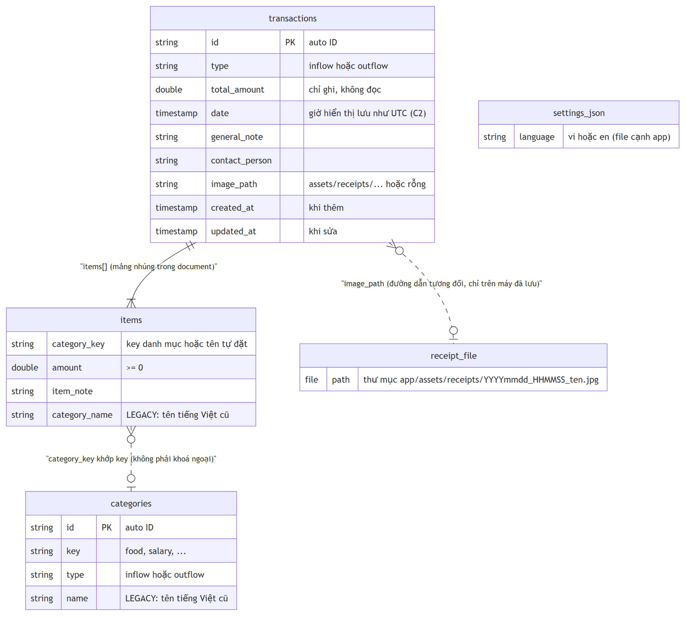

# 01 · Domain & hợp đồng dữ liệu

> Nguồn: commit `5614abe`. Đường dẫn `file.py:dòng` tính từ thư mục `app/`.
> File này là **hợp đồng cứng** giữa bản desktop và bản Android, vì hai app dùng chung một database Firestore.

## Entity

### `TransactionType`

| Giá trị | Ý nghĩa | Nhãn ngắn (key) | Nhãn dài (key) |
|---------|---------|-----------------|----------------|
| `inflow` | Khoản thu | `type.inflow` | `type_long.inflow` |
| `outflow` | Khoản chi | `type.outflow` | `type_long.outflow` |

### `TransactionItem`: một hạng mục trong giao dịch

| Field | Kiểu | Ràng buộc |
|-------|------|-----------|
| `category_key` | string | Không rỗng sau khi `trim` (BR-02) |
| `amount` | số thực (VND) | `>= 0` (BR-03) |
| `note` | string | Mặc định `""` |

### `Transaction`: một giao dịch gồm nhiều hạng mục

| Field | Kiểu | Ghi chú |
|-------|------|---------|
| `id` | string? | ID document Firestore; `null` khi chưa lưu |
| `type` | `TransactionType` | |
| `date` | ngày giờ không có múi giờ | Giờ hiển thị (xem [Quy ước thời gian](#quy-ước-thời-gian)) |
| `items` | danh sách `TransactionItem` | Ít nhất 1 phần tử (BR-01) |
| `general_note` | string | Ghi chú chung |
| `contact_person` | string | "Đối tác" |
| `receipt_path` | string | Đường dẫn tương đối của ảnh biên lai, `""` nếu không có |
| `total` *(tính toán)* | số thực | Tổng `amount` của các hạng mục (BR-04) |

Tạo `Transaction` vi phạm BR-01/02/03 sẽ ném `InvalidTransaction` (`domain/entities.py:33-40`).

### Tổng hợp theo kỳ

| Kiểu | Field | Ghi chú |
|------|-------|---------|
| `PeriodSummary` | `inflow`, `outflow`, `balance` | `balance = inflow − outflow` (BR-05) |
| `CategoryTotal` | `category_key`, `total` | Một dòng của biểu đồ / thống kê |
| `PeriodReport` | `start`, `end`, `transactions`, `summary`, `inflow_by_category`, `outflow_by_category` | Mọi số liệu được tính từ **một** lần đọc Firestore (`application/transaction_service.py:18`) |

Lỗi nghiệp vụ: `InvalidTransaction` (giao dịch không hợp lệ), `NoDataError` (xuất báo cáo cho kỳ không có giao dịch, `application/report_service.py:8`).

## Quy tắc nghiệp vụ

| ID | Quy tắc | Nguồn |
|----|---------|-------|
| **BR-01** | Giao dịch phải có ít nhất 1 hạng mục. | `domain/entities.py:34` |
| **BR-02** | Mỗi hạng mục phải có `category_key` không rỗng sau `trim`. | `domain/entities.py:37` |
| **BR-03** | `amount >= 0`. Form chỉ lấy những dòng có số tiền `> 0`; dòng 0 hoặc để trống bị bỏ qua mà không báo. | `domain/entities.py:39`, `presentation/transaction_form.py:175` |
| **BR-04** | Tổng giao dịch = tổng `amount` của các hạng mục. | `domain/entities.py:43` |
| **BR-05** | Tổng thu / tổng chi của kỳ = tổng `total` các giao dịch theo loại; số dư = thu − chi. | `domain/summary.py:35` |
| **BR-06** | Tổng theo danh mục: lọc theo loại, cộng `amount` theo `category_key`, sắp **giảm dần** theo tổng. Hai danh mục bằng tiền giữ thứ tự xuất hiện đầu tiên trong danh sách (danh sách xếp mới nhất trước). | `domain/summary.py:42-49` |
| **BR-07** | Kỳ lọc là `[ngày bắt đầu 00:00:00, ngày kết thúc 23:59:59]`, bao gồm cả hai đầu. Mặc định từ ngày 1 tháng hiện tại đến hôm nay. ⚠ As-is: không kiểm tra bắt đầu ≤ kết thúc; khoảng ngược cho danh sách rỗng. Khuyến nghị: Android chặn hoặc tự đảo hai ngày. | `presentation/main_window.py:28-29,147-148` |
| **BR-08** | Danh sách giao dịch xếp **mới nhất trước** (`date` giảm dần). Bảng kê trong báo cáo xếp **cũ nhất trước**. | `infrastructure/firestore_repository.py:32`, `presentation/word_exporter.py:51` |
| **BR-09** | Ngày giờ giao dịch = ngày chọn trên form + phần giờ của giao dịch gốc (khi sửa) hoặc giờ hiện tại (khi thêm). | `presentation/formatters.py:42` |
| **BR-10** | Parse tiền: bỏ mọi ký tự không phải chữ số `0-9`; chuỗi không còn chữ số nào → 0. VND không có phần lẻ. ⚠ As-is: `"1,5"` → 15, `"-200"` → 200, `"12abc3"` → 123. Khuyến nghị: Android dùng bàn phím số và không cho nhập ký tự khác. | `presentation/formatters.py:17` |
| **BR-11** | Từ chữ trong ô danh mục ra key: (1) trùng nhãn đang hiển thị → key của nhãn đó; (2) trùng tên tiếng Việt cũ (bảng [Tên cũ → key](#tên-danh-mục-cũ--key)) → key tương ứng; (3) còn lại → dùng nguyên văn làm key (**danh mục tự đặt**, không được thêm vào collection `categories`). Chữ rỗng → key rỗng → vi phạm BR-02. | `presentation/transaction_form.py:130-135` |
| **BR-12** | Nhãn danh mục: key mặc định thì dịch qua `category.<key>`; key khác (tự đặt) hiển thị nguyên văn. | `presentation/formatters.py:27` |
| **BR-13** | Ảnh biên lai mới được copy vào kho **trước** khi ghi Firestore. Copy lỗi thì không ghi gì. ⚠ As-is: copy xong mà ghi Firestore lỗi thì file ảnh bị mồ côi. | `application/transaction_service.py:28-35` |
| **BR-14** | Khi khởi động, nếu collection `categories` rỗng thì seed 11 danh mục mặc định (xem [Seed](#seed-danh-mục-mặc-định)). | `infrastructure/firestore_repository.py:57-62` |
| **BR-15** | Đọc được dữ liệu legacy và field bị thiếu theo mục [Đọc dữ liệu cũ](#đọc-dữ-liệu-cũ-và-giá-trị-thiếu). | `infrastructure/firestore_mapping.py:23-44` |
| **BR-16** | Ngôn ngữ giao diện chỉ nhận `vi` hoặc `en`, mặc định `vi`. | `presentation/i18n.py:7-8,33-39` |

## Hợp đồng Firestore



### Collection `transactions`

Document ID do Firestore tự sinh (`add()`).

| Field | Kiểu Firestore | Ghi khi | Đọc như thế nào |
|-------|----------------|---------|-----------------|
| `type` | string `"inflow"` / `"outflow"` | thêm, sửa | Bắt buộc. Giá trị lạ → lỗi cả lần tải (xem bên dưới) |
| `total_amount` | double | thêm, sửa | **Không đọc.** Chỉ ghi để bản cũ còn hiển thị được. Bằng tổng `items[].amount` |
| `items` | array of map | thêm, sửa | Mỗi phần tử: |
| ↳ `category_key` | string | thêm, sửa | Thiếu → suy từ `category_name` |
| ↳ `amount` | double | thêm, sửa | Thiếu → `0`. Bản desktop đọc cả số nguyên lẫn số thực |
| ↳ `item_note` | string | thêm, sửa | Thiếu / `null` → `""` |
| ↳ `category_name` | string *(legacy)* | không bao giờ | Tên tiếng Việt cũ, chỉ có ở dữ liệu cũ |
| `date` | timestamp | thêm, sửa | Bắt buộc. Theo quy ước giờ C2 |
| `general_note` | string | thêm, sửa | Thiếu / `null` → `""` |
| `image_path` | string | thêm, sửa | Thiếu / `null` → `""`. Xem [Ảnh biên lai](#ảnh-biên-lai) |
| `contact_person` | string | thêm, sửa | Thiếu / `null` → `""` |
| `created_at` | timestamp | chỉ khi thêm | Không đọc. Giờ máy lúc thêm, theo C2 |
| `updated_at` | timestamp | chỉ khi sửa | Không đọc. Giờ máy lúc sửa, theo C2 |

- **Thêm:** `collection("transactions").add(doc + created_at)`.
- **Sửa:** `document(id).update(doc + updated_at)`. Ghi đè toàn bộ các field ở trên (cả mảng `items`) và **giữ** `created_at`. Nếu document đã bị xoá (ví dụ ở máy khác) thì `update` thất bại với lỗi NotFound → hiện `error.generic`.
- **Xoá:** `document(id).delete()`. Không xoá file ảnh biên lai.
- **Truy vấn theo kỳ:** `where("date", ">=", start)`, `where("date", "<=", end)`, `orderBy("date", DESC)`. Chỉ dùng một field nên không cần composite index.

### Collection `categories`

| Field | Kiểu | Ghi chú |
|-------|------|---------|
| `key` | string | Key trung lập ngôn ngữ (`food`, `salary`...) |
| `type` | string `"inflow"` / `"outflow"` | |
| `name` | string *(legacy)* | Tên tiếng Việt cũ. Document cũ có thể chỉ có `name` mà không có `key` |

- **Đọc danh mục của một loại:** `where("type", "==", <loại>)`, không `orderBy`. Mỗi document cho ra `key`, hoặc nếu thiếu thì `legacy_name_to_key(name)`. Kết quả được **bỏ trùng và giữ thứ tự**. ⚠ As-is: không sắp xếp, nên thứ tự là thứ tự Firestore trả về (theo document ID). Hai app đọc cùng một truy vấn sẽ thấy cùng thứ tự.
- **Cache:** đọc một lần cho mỗi loại trong một phiên chạy app, không làm mới cho đến khi khởi động lại (`application/transaction_service.py:37-40`).
- App **không bao giờ** thêm, sửa hay xoá danh mục ngoài lúc seed.

#### Seed danh mục mặc định

Khi `categories.limit(1)` không trả về document nào, app thêm lần lượt các document `{key, type}`:

| `type` | `key` (theo thứ tự) |
|--------|---------------------|
| `inflow` | `salary`, `bonus`, `passive_income`, `sales`, `other` |
| `outflow` | `food`, `bills`, `transport`, `shopping`, `health`, `entertainment`, `other` |

#### Tên danh mục cũ → key

Áp dụng sau khi chuẩn hoá Unicode **NFC** và `trim` (`domain/categories.py:14-34`). Tên không có trong bảng thì giữ nguyên làm key; tên rỗng hoặc thiếu → `other`.

| Tên cũ | key | Tên cũ | key |
|--------|-----|--------|-----|
| Lương | `salary` | Ăn uống | `food` |
| Thưởng | `bonus` | Hóa đơn | `bills` |
| Thu nhập thụ động | `passive_income` | Di chuyển | `transport` |
| Bán hàng | `sales` | Mua sắm | `shopping` |
| Khác | `other` | Sức khỏe | `health` |
| | | Giải trí | `entertainment` |

## Đọc dữ liệu cũ và giá trị thiếu

| Trường hợp | Cách xử lý |
|------------|------------|
| Item có `category_name` nhưng không có `category_key` | `category_key = legacy_name_to_key(category_name)` |
| Item thiếu cả hai | `category_key = "other"` |
| Item thiếu `amount` | `0` |
| `general_note` / `contact_person` / `image_path` / `item_note` thiếu hoặc `null` | `""` |
| Category có `name` mà không có `key` | `legacy_name_to_key(name)` |
| `date` có múi giờ | Bỏ múi giờ, giữ nguyên giờ (C2) |

⚠ As-is: chỉ cần **một** document trong kỳ bị hỏng (`items` rỗng, `amount` âm, `type` lạ hoặc thiếu `date`) là **cả lần tải kỳ thất bại**. Người dùng thấy `error.invalid_transaction` hoặc `error.generic`, bảng không đổi. Khuyến nghị: Android bỏ qua document hỏng, ghi log, và vẫn hiển thị phần còn lại.

## Quy ước thời gian

Desktop ghi `datetime` **không có múi giờ** (giờ máy, Việt Nam UTC+7). Thư viện `google-cloud-firestore` coi datetime không múi giờ là UTC (`google/cloud/_helpers/__init__.py`, hàm `_microseconds_from_datetime`, đã kiểm chứng trong `.venv`). Khi đọc lại, desktop bỏ phần múi giờ (`infrastructure/firestore_mapping.py:47-50`).

Hệ quả: **giờ UTC lưu trên Firestore bằng đúng giờ hiển thị**. Ví dụ: giao dịch lúc 10:00 sáng giờ Việt Nam được lưu là `10:00:00Z`, chứ không phải `03:00:00Z`. Quy tắc này áp dụng cho `date`, `created_at`, `updated_at` và cả hai mốc của truy vấn kỳ. Android phải theo quy ước này (ràng buộc **C2** trong [05-android-mapping.md](05-android-mapping.md)).

## Ảnh biên lai

- **Chọn ảnh:** chỉ nhận `*.jpg`, `*.jpeg`, `*.png`. Ảnh chưa được copy cho đến khi bấm Lưu.
- **Khi lưu:** copy vào `<thư mục app>/assets/receipts/` với tên `YYYYmmdd_HHMMSS_<tên file gốc>` (giờ máy lúc lưu). `image_path` nhận giá trị `assets/receipts/<tên mới>` (dùng dấu `/`) (`infrastructure/receipt_storage.py:13-18`).
- **Khi hiển thị:** `image_path` rỗng → không có ảnh. Đường dẫn tuyệt đối (dữ liệu rất cũ) được dùng nguyên văn. Đường dẫn tương đối được ghép với thư mục app. File không tồn tại → coi như không có ảnh (`infrastructure/receipt_storage.py:20-25`).
- **Khi sửa** mà không chọn ảnh mới: giữ `image_path` cũ. Không có cách gỡ ảnh khỏi giao dịch.
- Ảnh chỉ nằm trên máy đã lưu nó, các máy khác không mở được (xem **D2**).

## `settings.json`

File `settings.json` cạnh app, nội dung `{"language": "vi"}` hoặc `{"language": "en"}`. Thiếu file, JSON hỏng, hoặc `language` không phải `vi`/`en` → dùng `vi` (BR-16). Ghi lại mỗi lần đổi ngôn ngữ (`presentation/i18n.py:33-47`).

## Migration danh mục

`scripts/migrate_category_keys.py` (đã chạy trên dữ liệu thật trước khi viết spec này):

- Mặc định chạy **dry-run**: chỉ đọc và báo cáo.
- `--apply`: backup ra `backups/` rồi chỉ **thêm** field `key` (cho categories) và `category_key` (cho từng item). Không xoá `name` / `category_name`.
- Chạy lại nhiều lần vẫn an toàn.
- Dữ liệu chưa migrate vẫn đọc được nhờ BR-15, nên Android **bắt buộc** hỗ trợ đọc dạng legacy.

## 💡 Gợi ý Compose

```kotlin
enum class TransactionType(val value: String) { INFLOW("inflow"), OUTFLOW("outflow") }

data class TransactionItem(val categoryKey: String, val amount: Double, val note: String = "")

data class Transaction(
    val id: String?,
    val type: TransactionType,
    val date: LocalDateTime,          // giờ hiển thị; đổi sang Timestamp theo C2
    val items: List<TransactionItem>, // validate BR-01..03 trong use case / init
    val generalNote: String = "",
    val contactPerson: String = "",
    val receiptPath: String = "",
) { val total: Double get() = items.sumOf { it.amount } }
```

- Đọc số tiền bằng `(map["amount"] as? Number)?.toDouble() ?: 0.0`, để chấp nhận cả `Long` lẫn `Double`. Ghi luôn `Double`, giống desktop.
- Dùng `Map<String, Any?>` thủ công thay vì `toObject()`, vì cần các nhánh legacy ở BR-15.
- Ghi `total_amount` mỗi lần thêm hoặc sửa (ràng buộc C3).
