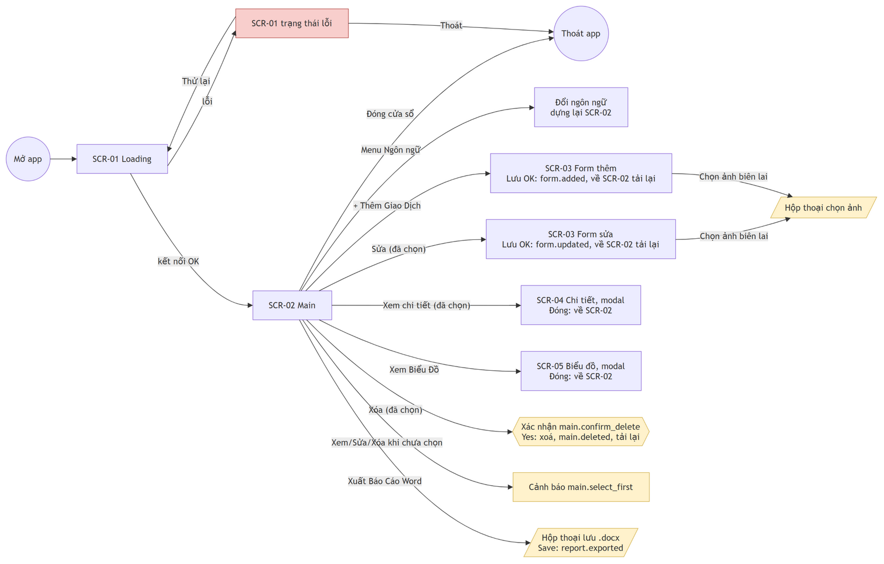
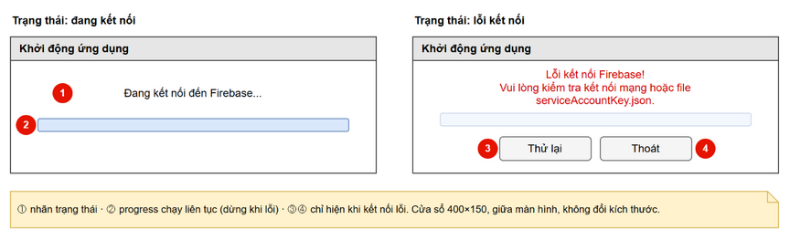
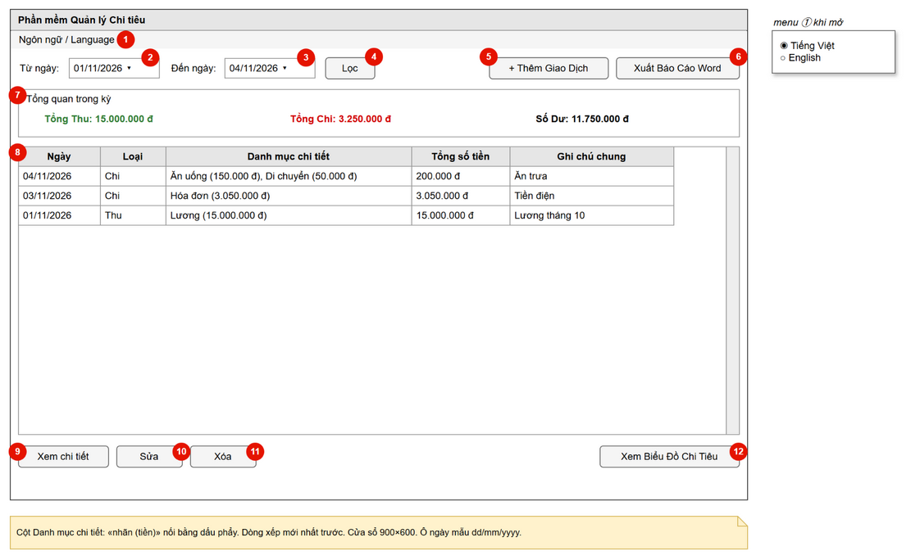
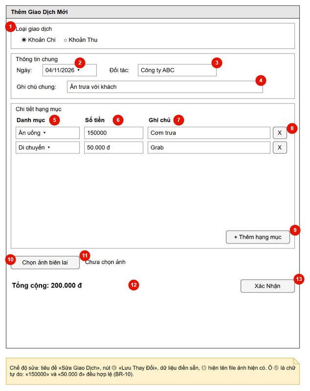
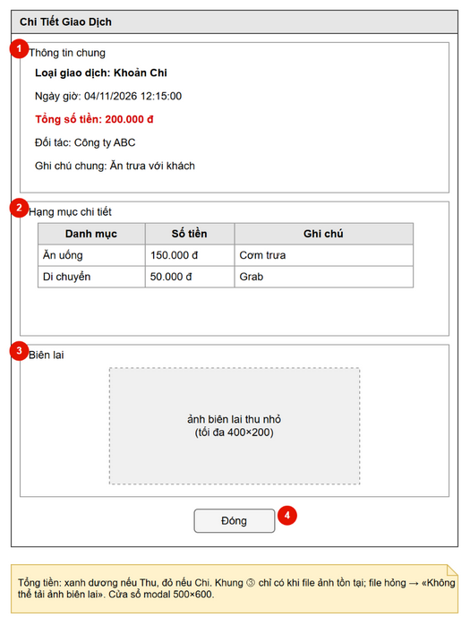
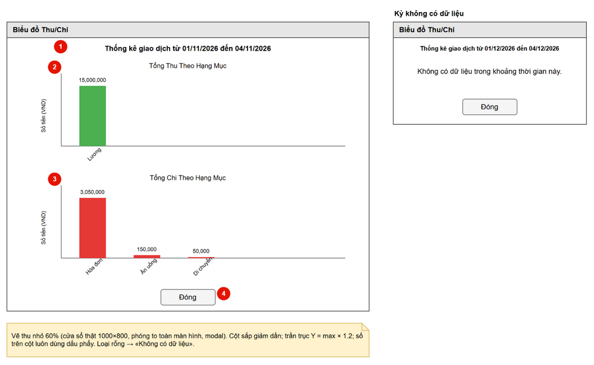

# 02 · Màn hình, thao tác & trạng thái

> Nguồn: `app/presentation/*.py` (commit `5614abe`). Chữ trên giao diện được ghi bằng **key i18n** (tra trong
> [04-i18n-format.md](04-i18n-format.md)). Số ①②③ trên wireframe khớp với cột `#` trong các bảng. Dòng có `#` là `—`
> là sự kiện không gắn với phần tử cụ thể nào (mở hoặc đóng cửa sổ...).

## Sơ đồ điều hướng

| Từ | Thao tác | Đến | Kiểu |
|----|----------|-----|------|
| — | Mở app | SCR-01 | Cửa sổ gốc |
| SCR-01 | Kết nối thành công | SCR-02 | SCR-01 đóng, SCR-02 mở (cửa sổ gốc mới) |
| SCR-01 | `loading.exit` hoặc đóng cửa sổ | Thoát app | |
| SCR-02 | `main.add` | SCR-03 (thêm) | Cửa sổ con, **không** modal |
| SCR-02 | `main.edit` (đã chọn dòng) | SCR-03 (sửa) | Cửa sổ con, **không** modal |
| SCR-02 | `main.view` (đã chọn dòng) | SCR-04 | Cửa sổ con modal |
| SCR-02 | `main.chart` | SCR-05 | Cửa sổ con modal, phóng to |
| SCR-02 | `main.delete` (đã chọn dòng) | Hộp xác nhận | Modal |
| SCR-02 | `main.export_word` | Hộp thoại lưu file | Modal của hệ điều hành |
| SCR-03 | `form.choose_receipt` | Hộp thoại chọn ảnh | Modal của hệ điều hành |
| SCR-03 | Lưu thành công | SCR-02 (tải lại) | Form đóng |
| SCR-04, SCR-05 | `dialog.close` | SCR-02 | |
| SCR-02 | Đóng cửa sổ | Thoát app | Đóng luôn mọi cửa sổ con |

## Hộp thoại dùng chung

| Loại | Tiêu đề (key) | Nút | Dùng cho |
|------|---------------|-----|----------|
| Lỗi | `dialog.error` | OK | Mọi lỗi, nội dung theo bảng bên dưới |
| Cảnh báo | `dialog.warning` | OK | `main.select_first` |
| Xác nhận | `dialog.confirm` | Yes / No | `main.confirm_delete` |
| Thông báo | `dialog.success` | OK | `main.deleted`, `form.added`, `form.updated`, `report.exported` |
| Chọn ảnh (hệ điều hành) | — | Open / Cancel | SCR-03 ⑩, bộ lọc `form.image_files` (`*.jpg *.jpeg *.png`) |
| Lưu file (hệ điều hành) | `report.save_title` | Save / Cancel | SCR-02 ⑥ |

Mọi thao tác có I/O đều chạy trong khối `reported_errors`. Khi có lỗi, các bước còn lại trong khối bị bỏ qua và hiện hộp thoại lỗi theo bảng sau (`app/presentation/ui_helpers.py:12-27`):

| Exception | Nội dung (key) |
|-----------|----------------|
| `InvalidTransaction` | `error.invalid_transaction` |
| `NoDataError` | `error.no_data` |
| `FileNotFoundError`, `PermissionError` | `error.file` (tham số `detail` = thông điệp lỗi gốc) |
| Mọi lỗi khác (Firestore, mạng, dữ liệu hỏng…) | `error.generic` (tham số `detail` = thông điệp lỗi gốc) |

Riêng ngày không hợp lệ trong bộ lọc được báo trực tiếp bằng `error.invalid_date`.

---

## SCR-01 Loading

Cửa sổ gốc 400×150, căn giữa màn hình, không đổi được kích thước, tiêu đề `loading.title`. Nguồn: `loading_window.py`.

### Thành phần

| # | Thành phần | Loại | Nhãn (key) | Mặc định / ghi chú |
|---|------------|------|------------|--------------------|
| ① | Nhãn trạng thái | Label | `loading.connecting` | Chữ đen. Lỗi → `loading.error` chữ đỏ; thử lại → `loading.reconnecting` chữ đen |
| ② | Thanh tiến trình | Progress bar không xác định | — | Chạy liên tục; dừng khi lỗi |
| ③ | Thử lại | Button | `loading.retry` | Chỉ hiện ở trạng thái lỗi |
| ④ | Thoát | Button | `loading.exit` | Chỉ hiện ở trạng thái lỗi |

### Sự kiện

| # | Thao tác | Điều kiện | Kết quả |
|---|----------|-----------|---------|
| — | Mở app | — | Chạy UC-01 ở thread nền; luồng giao diện kiểm tra kết quả mỗi 100 ms |
| — | Kết nối xong | Thành công | Đóng SCR-01, mở SCR-02 |
| — | Kết nối xong | Lỗi bất kỳ (thiếu hoặc hỏng `serviceAccountKey.json`, mất mạng…) | ② dừng; ① = `loading.error` (đỏ); hiện ③ ④ |
| ③ | Bấm Thử lại | Đang ở trạng thái lỗi | Ẩn ③ ④; ① = `loading.reconnecting`; ② chạy lại; kết nối lại từ đầu |
| ④ | Bấm Thoát | Đang ở trạng thái lỗi | Đóng cửa sổ, thoát app, không mở SCR-02 |
| — | Đóng cửa sổ (nút X) | Bất kỳ lúc nào | Thoát app, không mở SCR-02 |

### Trạng thái

`connecting` (①②) → `error` (①②③④) → `connecting` (bấm ③) … hoặc `connecting` → thành công → chuyển sang SCR-02.

💡 **Gợi ý Compose:** màn khởi tạo (splash). Bản Android không có bước "kết nối" tường minh (D4): màn này kiểm tra đăng nhập (D1), seed danh mục (BR-14), rồi điều hướng. Lỗi hiện nút Thử lại / Thoát giống as-is.

---

## SCR-02 Main

Cửa sổ gốc 900×600, tiêu đề `main.title`. Nguồn: `main_window.py`.

### Thành phần

| # | Thành phần | Loại | Nhãn (key) | Mặc định / ghi chú |
|---|------------|------|------------|--------------------|
| ① | Menu ngôn ngữ | Menu bar → 2 radio | `menu.language` → `language.vi`, `language.en` | Đánh dấu ngôn ngữ hiện tại |
| ② | Từ ngày | Nhãn `main.from` + ô chọn ngày | `main.from` | Ngày 1 của tháng hiện tại, mẫu `dd/mm/yyyy` |
| ③ | Đến ngày | Nhãn `main.to` + ô chọn ngày | `main.to` | Hôm nay |
| ④ | Lọc | Button | `main.filter` | |
| ⑤ | Thêm giao dịch | Button (căn phải) | `main.add` | |
| ⑥ | Xuất báo cáo | Button (sát mép phải) | `main.export_word` | |
| ⑦ | Tổng quan trong kỳ | Khung `main.summary` chứa 3 nhãn đậm chia đều | `summary.inflow` (xanh lá), `summary.outflow` (đỏ), `summary.balance` (đen) | Trước khi tải xong hiển thị 0 |
| ⑧ | Bảng giao dịch | Bảng 5 cột + thanh cuộn dọc | Cột: `main.col_date` (100, trái), `main.col_type` (80, trái), `main.col_category` (300, trái), `main.col_amount` (120, phải), `main.col_note` (200, trái) | Mỗi dòng là một giao dịch, xếp mới nhất trước (BR-08) |
| ⑨ | Xem chi tiết | Button (trái) | `main.view` | |
| ⑩ | Sửa | Button (trái) | `main.edit` | |
| ⑪ | Xóa | Button (trái) | `main.delete` | |
| ⑫ | Xem biểu đồ | Button (phải) | `main.chart` | |

Nội dung một dòng của ⑧:
- **Ngày:** `dd/MM/yyyy`.
- **Loại:** `type.<type>`.
- **Danh mục chi tiết:** các hạng mục nối bằng `, `, mỗi hạng mục là `<nhãn danh mục> (<tiền>)`. Ví dụ: `Ăn uống (150.000 đ), Di chuyển (50.000 đ)`.
- **Tổng số tiền:** tổng giao dịch.
- **Ghi chú chung:** `general_note`.

Mỗi dòng gắn với ID document Firestore.

### Sự kiện

| # | Thao tác | Điều kiện | Kết quả |
|---|----------|-----------|---------|
| — | Mở màn hình | — | Tải kỳ mặc định (UC-02). Lỗi → `error.generic` (hoặc `error.invalid_transaction` nếu có document hỏng); bảng rỗng, tổng = 0 |
| ① | Chọn một ngôn ngữ | — | UC-09: lưu `settings.json` (lỗi → `error.file` / `error.generic`, giao diện **vẫn** đổi), dựng lại toàn bộ SCR-02, hiển thị lại dữ liệu đã tải mà không gọi Firestore. ⚠ As-is: ② ③ quay về kỳ đang áp dụng, mất ngày đã gõ mà chưa bấm ④ |
| ② ③ | Chọn hoặc gõ ngày | — | Chỉ đổi giá trị ô, chưa tải lại |
| ④ | Bấm Lọc | Một trong hai ô ngày không hợp lệ | `error.invalid_date`, giữ kỳ cũ |
| ④ | Bấm Lọc | Hợp lệ | Kỳ mới = [② 00:00:00, ③ 23:59:59] (BR-07), tải lại từ Firestore, vẽ lại ⑦ ⑧. Lỗi → `error.generic` |
| ⑤ | Bấm Thêm | — | Mở SCR-03 chế độ thêm. Lưu thành công → tải lại kỳ hiện tại |
| ⑧ | Click một dòng | — | Chọn dòng đó. ⚠ As-is: Ctrl/Shift-click chọn được nhiều dòng nhưng ⑨ ⑩ ⑪ chỉ dùng dòng **đầu tiên** được chọn. Double-click không làm gì |
| ⑨ ⑩ ⑪ | Bấm Xem / Sửa / Xóa | Chưa chọn dòng nào | Cảnh báo `main.select_first` |
| ⑨ | Bấm Xem chi tiết | Đã chọn | Tìm file ảnh biên lai, mở SCR-04 (UC-05) |
| ⑩ | Bấm Sửa | Đã chọn | Mở SCR-03 chế độ sửa với dữ liệu **đang hiển thị** (UC-04). ⚠ As-is: không đọc lại Firestore. Lưu thành công → tải lại |
| ⑪ | Bấm Xóa | Đã chọn | Hỏi `main.confirm_delete` (UC-06). No → thôi. Yes → xoá trên Firestore → `main.deleted` → tải lại. Lỗi → `error.generic`, **vẫn** tải lại |
| ⑫ | Bấm Xem biểu đồ | Đã có dữ liệu kỳ | Mở SCR-05 với dữ liệu kỳ **đang hiển thị**, không tải lại (UC-07) |
| ⑫ | Bấm Xem biểu đồ | Lần tải đầu đã lỗi (chưa có dữ liệu) | Không làm gì. ⚠ As-is: không báo gì |
| ⑥ | Bấm Xuất báo cáo | — | Hộp thoại lưu file: tiêu đề `report.save_title`, thư mục `~/Desktop`, tên gợi ý `<report.file_prefix>_yyyyMMdd_HHmmss.docx`, bộ lọc `report.file_type` (`*.docx`) và `dialog.all_files` (`*.*`) |
| ⑥ | Hộp thoại lưu file | Bấm Cancel | Không làm gì |
| ⑥ | Hộp thoại lưu file | Chọn đường dẫn | UC-08: **đọc lại** kỳ từ Firestore. Kỳ rỗng → `error.no_data`. Ghi file lỗi (ví dụ file đang mở trong Word) → `error.file`. Lỗi khác → `error.generic`. Thành công → `report.exported` (tham số `path`) |
| — | Đóng cửa sổ | — | Thoát app |

### Trạng thái

- **Đã tải:** ⑦ ⑧ hiển thị kỳ hiện tại.
- **Rỗng:** bảng không có dòng, tổng = 0. Không có thông báo "không có dữ liệu".
- **Lỗi tải:** hộp thoại lỗi; bảng giữ nội dung cũ, hoặc rỗng nếu là lần tải đầu.
- **Đang tải:** không có chỉ báo, giao diện bị chặn trong lúc gọi Firestore.

💡 **Gợi ý Compose:**
- `Scaffold` với `TopAppBar` (menu ngôn ngữ trong overflow), hàng chọn kỳ (`DateRangePicker` hoặc 2 `DatePicker`), 3 thẻ tổng quan, `LazyColumn` card.
- **Tap** card → SCR-04; Sửa/Xoá qua menu ba chấm hoặc swipe; FAB cho ⑤.
- Mô hình "chọn dòng rồi bấm nút" và cảnh báo `main.select_first` không còn cần thiết.
- Có chỉ báo loading và trạng thái rỗng rõ ràng.

---

## SCR-03 Form Thêm / Sửa giao dịch

Cửa sổ con 600×700. Tiêu đề `form.title_add` (thêm) hoặc `form.title_edit` (sửa). ⚠ As-is: không modal, người dùng vẫn bấm được SCR-02 khi form đang mở (kể cả mở thêm form khác). Nguồn: `transaction_form.py`.

### Thành phần

| # | Thành phần | Loại | Nhãn (key) | Mặc định / ghi chú |
|---|------------|------|------------|--------------------|
| ① | Loại giao dịch | Khung `form.type_frame` chứa 2 radio | `type_long.outflow`, `type_long.inflow` | Thêm: Chi. Sửa: loại của giao dịch |
| ② | Ngày | Nhãn `form.date` + ô chọn ngày (`dd/mm/yyyy`) | `form.date` | Thêm: hôm nay. Sửa: ngày giao dịch. Nằm trong khung `form.general_frame` |
| ③ | Đối tác | Nhãn `form.contact` + ô nhập (rộng 20 ký tự) | `form.contact` | Sửa: `contact_person` |
| ④ | Ghi chú chung | Nhãn `form.note` + ô nhập (rộng 50 ký tự) | `form.note` | Sửa: `general_note` |
| ⑤ | Danh mục (mỗi dòng) | Combobox **cho phép gõ** | Tiêu đề cột `form.col_category` | Danh sách = nhãn danh mục của loại đang chọn (BR-12). Mặc định chọn mục đầu tiên. Khung chứa: `form.items_frame` |
| ⑥ | Số tiền (mỗi dòng) | Ô nhập chữ tự do | `form.col_amount` | Thêm: trống. Sửa: dạng `1.500.000 đ` |
| ⑦ | Ghi chú hạng mục (mỗi dòng) | Ô nhập | `form.col_note` | |
| ⑧ | Xoá dòng | Button `X` | — | |
| ⑨ | Thêm hạng mục | Button | `form.add_item` | |
| ⑩ | Chọn ảnh | Button | `form.choose_receipt` | |
| ⑪ | Tên ảnh | Label | `form.no_receipt` | Sửa và có ảnh: tên file của `image_path` |
| ⑫ | Tổng cộng | Label đậm | `form.total` | Cập nhật mỗi lần gõ vào ⑥ |
| ⑬ | Lưu | Button | `form.save_new` (thêm) / `form.save_edit` (sửa) | |

Khởi tạo:
- **Thêm:** 1 dòng hạng mục trống.
- **Sửa:** mỗi hạng mục một dòng (⑤ = nhãn danh mục, kể cả danh mục tự đặt; ⑥ = tiền đã định dạng; ⑦ = ghi chú); điền ② ③ ④ ⑪.

### Sự kiện

| # | Thao tác | Điều kiện | Kết quả |
|---|----------|-----------|---------|
| ① | Đổi loại | — | Nạp danh sách danh mục của loại mới (đọc một lần mỗi phiên rồi cache). **Mọi** dòng đổi danh sách ⑤ và **reset về mục đầu tiên**. ⚠ As-is: mất danh mục đã chọn, kể cả ở chế độ sửa. Khuyến nghị: chỉ reset những dòng có danh mục không thuộc loại mới. Nạp lỗi → `error.generic`, danh sách rỗng |
| ② | Chọn ngày | — | Chỉ lấy phần ngày; phần giờ theo BR-09 |
| ⑤ | Chọn từ danh sách hoặc gõ chữ | — | Khi lưu, chữ được đổi thành key theo BR-11. Gõ tên mới = tạo danh mục tự đặt cho hạng mục này |
| ⑥ | Gõ số tiền | — | ⑫ = tổng parse (BR-10) của mọi dòng, cập nhật theo từng phím |
| ⑧ | Bấm `X` | Còn ≥ 2 dòng | Xoá dòng, cập nhật ⑫ |
| ⑧ | Bấm `X` | Chỉ còn 1 dòng | Không làm gì, không báo gì |
| ⑨ | Bấm Thêm hạng mục | — | Thêm dòng mới ở cuối (⑤ = mục đầu tiên, ⑥ ⑦ trống), cập nhật ⑫ |
| ⑩ | Bấm Chọn ảnh | — | Hộp thoại chọn ảnh, bộ lọc `form.image_files`. Cancel → giữ nguyên. Chọn file → ⑪ = tên file (ảnh **chưa** được copy) |
| ⑬ | Bấm Lưu | — | UC-03 / UC-04: (1) lấy các dòng có tiền > 0, dòng khác bị bỏ qua mà không báo; (2) đổi ⑤ → key (BR-11); (3) ghép ngày giờ (BR-09); (4) kiểm tra BR-01/02; (5) copy ảnh mới nếu có (BR-13); (6) ghi Firestore |
| ⑬ | Lưu | Không còn dòng nào có tiền > 0, hoặc một dòng có tiền nhưng ⑤ trống | `error.invalid_transaction`; form giữ nguyên |
| ⑬ | Lưu | Copy ảnh lỗi (file đã bị xoá, không có quyền) | `error.file` (hoặc `error.generic`); không ghi Firestore; form giữ nguyên |
| ⑬ | Lưu | Ghi Firestore lỗi (mạng, document đã bị xoá ở máy khác…) | `error.generic`; form giữ nguyên |
| ⑬ | Lưu | Thành công | `form.added` (thêm) / `form.updated` (sửa) → SCR-02 tải lại → form đóng |
| — | Đóng cửa sổ (nút X) | — | Bỏ mọi thay đổi, không hỏi lại |

### Trạng thái

Form chỉ có trạng thái **nhập liệu**. Không có trạng thái "đang lưu"; giao diện bị chặn trong lúc ghi. Không có validate từng ô; mọi lỗi chỉ báo khi bấm ⑬.

💡 **Gợi ý Compose:**
- Màn full-screen (hoặc `ModalBottomSheet`) với `SegmentedButton` cho ①.
- `ExposedDropdownMenuBox` cho ⑤, có thể gõ để giữ được danh mục tự đặt.
- `OutlinedTextField` cho ⑥ dùng `KeyboardType.Number` và hiển thị phân cách hàng nghìn.
- Photo Picker cho ⑩.
- Nút Lưu bị khoá trong lúc ghi.
- Hỏi lại khi bấm Back mà form đã có thay đổi (khác as-is, tuỳ team).

---

## SCR-04 Chi tiết giao dịch

Cửa sổ con modal 500×600, tiêu đề `detail.title`. Nguồn: `transaction_detail.py`.

### Thành phần

| # | Thành phần | Loại | Nhãn (key) | Ghi chú |
|---|------------|------|------------|---------|
| ① | Thông tin chung | Khung `detail.general` chứa 5 nhãn | `detail.type` (đậm, `type_long.*`), `detail.date` (`dd/MM/yyyy HH:mm:ss`), `detail.total` (đậm; **xanh dương** nếu Thu, **đỏ** nếu Chi), `detail.contact`, `detail.note` | Giá trị rỗng vẫn hiện nhãn, phần sau dấu `:` để trống |
| ② | Hạng mục | Khung `detail.items` chứa bảng 3 cột | `form.col_category` (120, trái), `form.col_amount` (100, phải), `form.col_note` (200, trái) | Cao 5 dòng, nhiều hơn thì cuộn |
| ③ | Biên lai | Khung `detail.receipt` chứa ảnh thu nhỏ | — | Chỉ hiện khi file ảnh tồn tại; thu nhỏ vừa khung 400×200, giữ tỉ lệ. File không đọc được thành ảnh → nhãn `detail.receipt_error` |
| ④ | Đóng | Button | `dialog.close` | |

### Sự kiện

| # | Thao tác | Điều kiện | Kết quả |
|---|----------|-----------|---------|
| — | Mở | `image_path` rỗng hoặc file không tồn tại | Không có khung ③ |
| — | Mở | File tồn tại nhưng hỏng | Khung ③ chứa `detail.receipt_error` |
| ④ | Bấm Đóng | — | Đóng, quay lại SCR-02 |
| — | Đóng cửa sổ | — | Như ④ |

💡 **Gợi ý Compose:** màn chi tiết, có hành động Sửa / Xoá trên `TopAppBar` (thay cho ⑩ ⑪ của SCR-02). Ảnh hiển thị bằng Coil; tap ảnh để phóng to.

---

## SCR-05 Biểu đồ

Cửa sổ con modal 1000×800, phóng to toàn màn hình trên Windows, tiêu đề `chart.window_title`. Nguồn: `chart_view.py`, `charts.py`.

### Thành phần

| # | Thành phần | Loại | Nhãn (key) | Ghi chú |
|---|------------|------|------------|---------|
| ① | Tiêu đề | Label đậm cỡ 14 | `chart.heading` (tham số `start`, `end` dạng `dd/MM/yyyy`) | Kỳ đang hiển thị trên SCR-02 |
| ② | Biểu đồ thu | Biểu đồ cột, màu xanh lá | Tiêu đề `chart.inflow_title`, trục Y `chart.y_label` | Theo BR-06 cho `inflow` |
| ③ | Biểu đồ chi | Biểu đồ cột, màu đỏ | Tiêu đề `chart.outflow_title`, trục Y `chart.y_label` | Theo BR-06 cho `outflow` |
| ④ | Đóng | Button | `dialog.close` | |

Quy tắc vẽ ② ③ (`charts.py`):
- Mỗi cột là một danh mục, sắp giảm dần (BR-06). Nhãn trục X là nhãn danh mục (BR-12), xoay 45°.
- Trục Y bắt đầu từ 0, trần = `max(giá trị lớn nhất × 1.2, 1)`. Nhãn trục Y là số nguyên có dấu `,`.
- Trên đỉnh mỗi cột ghi giá trị dạng `1,500,000` (luôn dùng dấu `,`).
- Loại nào không có dữ liệu thì ô đó hiện `chart.no_data` ở giữa và ẩn trục.

### Sự kiện

| # | Thao tác | Điều kiện | Kết quả |
|---|----------|-----------|---------|
| — | Mở | Cả thu và chi đều rỗng | Thay ② ③ bằng một nhãn `chart.no_data_period` |
| — | Mở | Chỉ một loại rỗng | Ô của loại đó hiện `chart.no_data` |
| ④ | Bấm Đóng | — | Đóng, quay lại SCR-02 |

💡 **Gợi ý Compose:** vẽ bằng `Canvas` (cột, nhãn) hoặc thư viện Vico; cuộn dọc nếu nhiều danh mục; định dạng số trên biểu đồ nên theo ngôn ngữ (khác as-is).

---

## Báo cáo Word

Nguồn: `word_exporter.py`. Ngôn ngữ trong báo cáo là ngôn ngữ giao diện lúc xuất. Dữ liệu được **đọc lại** từ Firestore cho kỳ đang áp dụng (UC-08).

1. Tiêu đề cấp 0: `report.title`.
2. Đoạn: `report.period` (`start`, `end` dạng `dd/MM/yyyy`).
3. Đoạn: `report.exported_at` (giờ hiện tại dạng `dd/MM/yyyy HH:mm:ss`).
4. Tiêu đề cấp 1 `report.section_overview`, theo sau là một đoạn gồm 3 dòng chữ đậm: `summary.inflow`, `summary.outflow`, `report.balance`.
5. Tiêu đề cấp 1 `report.section_charts`, theo sau là 2 ảnh biểu đồ (thu rồi chi), rộng 6 inch, cùng quy tắc vẽ với SCR-05 ② ③.
6. Tiêu đề cấp 1 `report.section_details`, theo sau là bảng có viền (`Table Grid`):
   - 5 cột: `report.col_date`, `report.col_type`, `report.col_items`, `report.col_total`, `report.col_note`.
   - Mỗi giao dịch một dòng, xếp **cũ nhất trước** (BR-08).
   - Ô hạng mục: mỗi hạng mục một dòng, dạng `- <nhãn danh mục>[report.item_purpose]: <tiền>`. Phần `report.item_purpose` (` (Mục đích: <ghi chú>)`) chỉ có khi hạng mục có ghi chú.

💡 **Gợi ý Compose:** xem **D3** trong [05-android-mapping.md](05-android-mapping.md): xuất PDF với cùng cấu trúc 6 phần trên.
