# 03 · Use case, rẽ nhánh & sequence

> Nguồn: `app/presentation/*.py`, `app/application/*.py`, `app/infrastructure/*.py` (commit `5614abe`).
> Tác nhân duy nhất là **Người dùng**. Hệ thống ngoài là **Firestore** và **ổ đĩa** (ảnh biên lai, `settings.json`, file báo cáo).
> Ký hiệu nhánh: `A1..` = luồng thay thế (vẫn kết thúc bình thường), `E1..` = luồng lỗi. Trên activity diagram, nhánh thay thế tô **vàng**, nhánh lỗi tô **đỏ**.
> Tiêu chí nghiệm thu viết dạng Given/When/Then để team Android chuyển thẳng thành test.

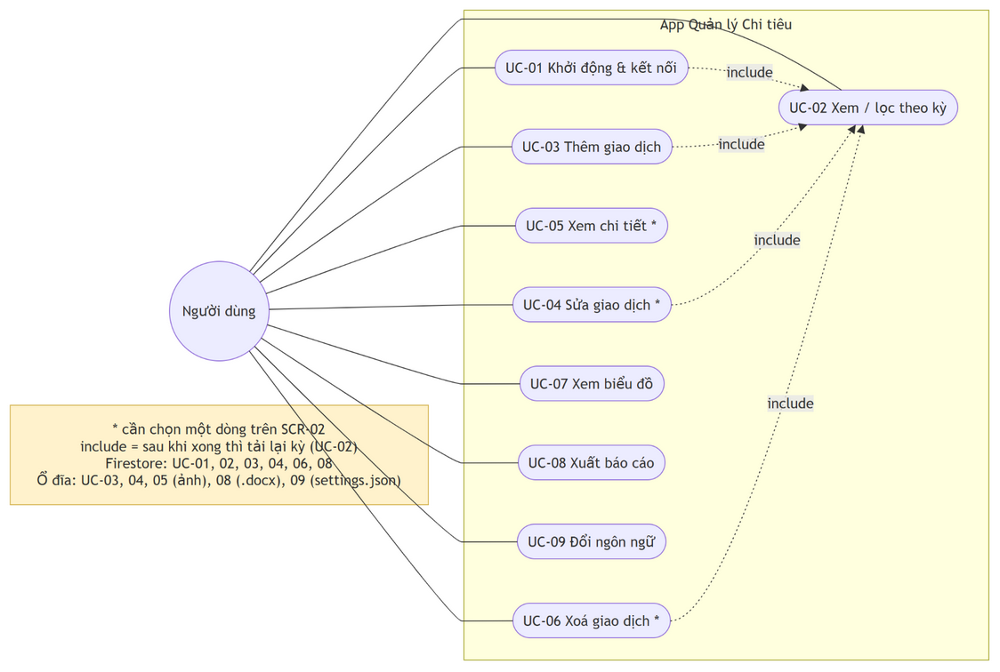

| UC | Tên | Màn hình | Activity | Sequence |
|----|-----|----------|----------|----------|
| UC-01 | Khởi động & kết nối | SCR-01 → SCR-02 | `act-uc01` | `seq-uc01` |
| UC-02 | Xem / lọc giao dịch theo kỳ | SCR-02 | `act-uc02` | `seq-uc02` |
| UC-03 | Thêm giao dịch | SCR-02 → SCR-03 | `act-uc03-04` | `seq-uc03-04` |
| UC-04 | Sửa giao dịch | SCR-02 → SCR-03 | `act-uc03-04` | `seq-uc03-04` |
| UC-05 | Xem chi tiết giao dịch | SCR-02 → SCR-04 | `act-uc05` | `seq-uc05` |
| UC-06 | Xoá giao dịch | SCR-02 | `act-uc06` | `seq-uc06` |
| UC-07 | Xem biểu đồ | SCR-02 → SCR-05 | `act-uc07` | — (không có I/O) |
| UC-08 | Xuất báo cáo | SCR-02 | `act-uc08` | `seq-uc08` |
| UC-09 | Đổi ngôn ngữ | SCR-02 | `act-uc09` | — (chỉ ghi một file nhỏ) |

---

## UC-01 Khởi động & kết nối

| | |
|---|---|
| Màn hình | SCR-01, sau đó SCR-02 |
| Tiền điều kiện | Có file `serviceAccountKey.json` cạnh app (bản desktop) |
| Kích hoạt | Mở app |
| Hậu điều kiện | Thành công: SCR-02 hiển thị kỳ mặc định; collection `categories` có ít nhất các danh mục mặc định |

**Luồng chính**
1. Hiện SCR-01, ① = `loading.connecting`, progress chạy.
2. Một thread nền khởi tạo Firebase bằng service account (chỉ khởi tạo một lần trong suốt vòng đời process).
3. Đọc `categories.limit(1)`. Nếu rỗng thì seed 11 danh mục mặc định (BR-14).
4. Tạo các service.
5. Luồng giao diện, vốn kiểm tra mỗi 100 ms, nhận kết quả thành công → đóng SCR-01 → mở SCR-02 → chạy UC-02 với kỳ mặc định.

**Luồng thay thế**
- **A1 Thử lại:** từ E1, người dùng bấm `loading.retry` → ① = `loading.reconnecting` → quay lại bước 2.
- **A2 Thoát:** từ E1, người dùng bấm `loading.exit` hoặc đóng cửa sổ → thoát app, không mở SCR-02. Đóng cửa sổ khi đang kết nối cũng thoát.

**Luồng lỗi**
- **E1** Bước 2–4 lỗi (thiếu hoặc hỏng file key, mất mạng, Firestore từ chối) → progress dừng, ① = `loading.error` (chữ đỏ), hiện `loading.retry` và `loading.exit`.

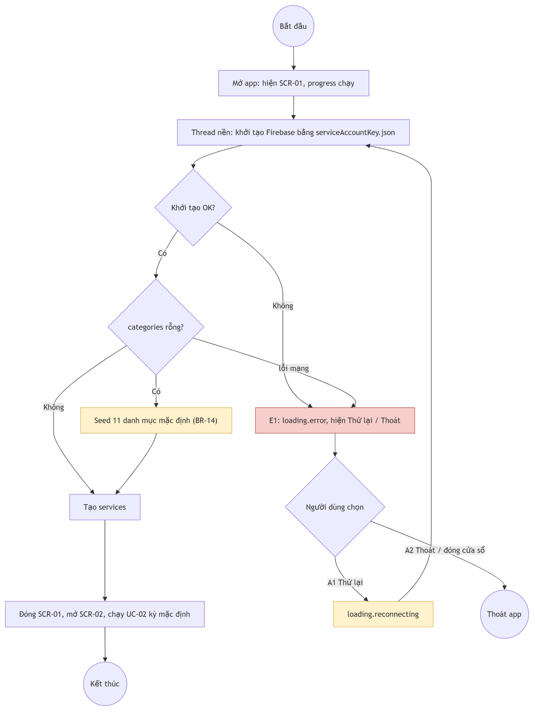
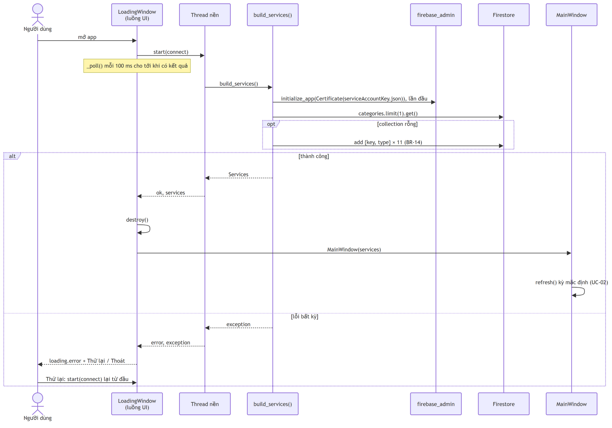

### Tiêu chí nghiệm thu
- **Given** mạng hoạt động và `categories` rỗng, **When** mở app, **Then** sau khi kết nối có đúng 11 document `{key, type}` theo thứ tự seed, và SCR-02 hiển thị.
- **Given** `categories` đã có dữ liệu, **When** mở app, **Then** không thêm document nào.
- **Given** mất mạng, **When** mở app, **Then** hiện `loading.error` cùng hai nút Thử lại / Thoát; **When** bật lại mạng và bấm Thử lại, **Then** vào được SCR-02.
- **Given** đang ở trạng thái lỗi, **When** bấm Thoát, **Then** app đóng và SCR-02 không bao giờ hiện.

---

## UC-02 Xem / lọc giao dịch theo kỳ

| | |
|---|---|
| Màn hình | SCR-02 |
| Tiền điều kiện | UC-01 thành công |
| Kích hoạt | Mở SCR-02 (kỳ mặc định), bấm `main.filter`, hoặc được UC-03/04/06 gọi để tải lại |
| Hậu điều kiện | ⑦ và ⑧ hiển thị đúng dữ liệu của kỳ; app giữ dữ liệu kỳ này trong bộ nhớ cho UC-04/05/06/07 |

**Luồng chính**
1. Người dùng chọn ② Từ ngày và ③ Đến ngày, bấm ④ Lọc.
2. Kỳ = [② 00:00:00, ③ 23:59:59] (BR-07).
3. Đọc Firestore: `date >= start`, `date <= end`, xếp `date` giảm dần.
4. Chuyển mỗi document thành `Transaction` (BR-15), tính tổng (BR-05) và tổng theo danh mục (BR-06), tất cả từ **một** lần đọc.
5. Hiển thị ⑦ tổng quan và ⑧ bảng (mới nhất trước).

**Luồng thay thế**
- **A1 Kỳ rỗng** (kể cả khi Từ ngày > Đến ngày): bảng trống, tổng = 0, không có thông báo.

**Luồng lỗi**
- **E1** Ô ngày không đọc được thành ngày → `error.invalid_date`, giữ nguyên kỳ cũ.
- **E2** Lỗi Firestore hoặc mạng → `error.generic`, bảng giữ nội dung cũ.
- **E3** Có document hỏng trong kỳ → `error.invalid_transaction` (hoặc `error.generic`), bảng giữ nội dung cũ. ⚠ As-is, xem [01-domain-data.md](01-domain-data.md#đọc-dữ-liệu-cũ-và-giá-trị-thiếu).

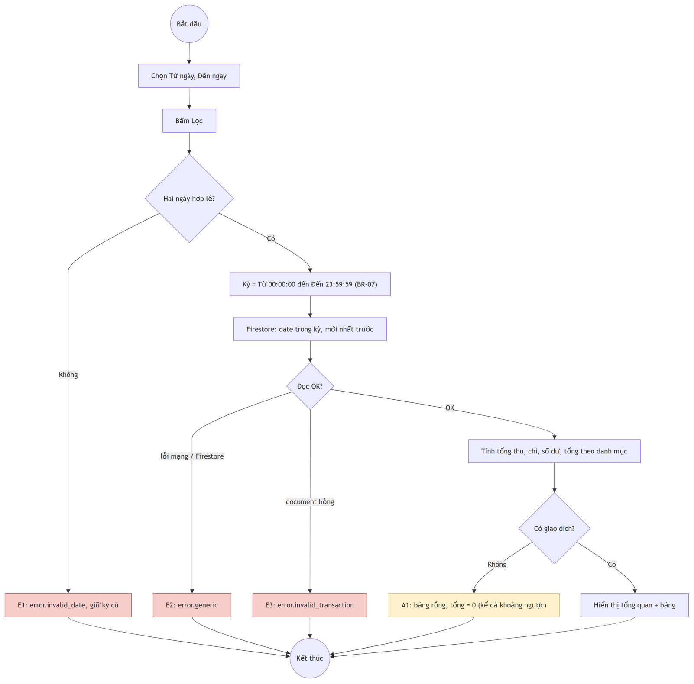
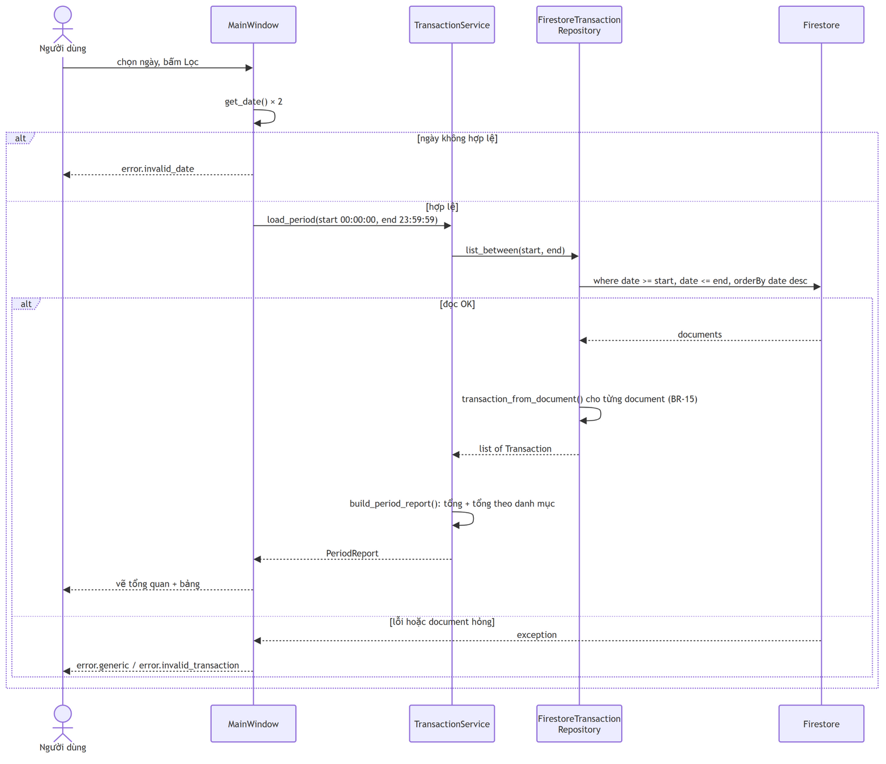

### Tiêu chí nghiệm thu
- **Given** hôm nay là 15/11/2026, **When** mở SCR-02, **Then** kỳ là 01/11/2026 00:00:00 – 15/11/2026 23:59:59.
- **Given** một giao dịch lúc 30/11/2026 23:59:59 và một giao dịch lúc 01/12/2026 00:00:00, **When** lọc 01/11/2026 – 30/11/2026, **Then** chỉ thấy giao dịch thứ nhất.
- **Given** thu 15.000.000 và chi 150.000 + 3.050.000 trong kỳ, **When** lọc, **Then** ⑦ hiện Tổng Thu `15.000.000 đ`, Tổng Chi `3.200.000 đ`, Số Dư `11.800.000 đ`.
- **Given** Từ ngày 10/11, Đến ngày 01/11, **When** bấm Lọc, **Then** bảng rỗng và không có lỗi (as-is).

---

## UC-03 Thêm giao dịch

| | |
|---|---|
| Màn hình | SCR-02 → SCR-03 (chế độ thêm) |
| Tiền điều kiện | Đang ở SCR-02 |
| Kích hoạt | Bấm `main.add` |
| Hậu điều kiện | Thành công: có một document mới trong `transactions` (kèm `created_at`); ảnh (nếu có) đã được copy vào `assets/receipts/`; SCR-02 đã tải lại |

**Luồng chính**
1. Mở SCR-03 gồm 1 dòng trống, loại = Chi, ngày = hôm nay, danh sách danh mục = danh mục chi.
2. Người dùng chọn loại, ngày, nhập đối tác, ghi chú, và các dòng hạng mục (danh mục, số tiền, ghi chú). `form.total` cập nhật theo từng phím gõ.
3. Bấm `form.save_new`.
4. Lấy các dòng có tiền > 0, đổi chữ danh mục thành key (BR-11), ngày giờ = ngày chọn + giờ hiện tại (BR-09).
5. Kiểm tra BR-01, BR-02.
6. Nếu đã chọn ảnh: copy vào kho (BR-13).
7. `transactions.add(document + created_at)`.
8. Thông báo `form.added` → SCR-02 tải lại (UC-02) → form đóng.

**Luồng thay thế**
- **A1 Đổi loại:** nạp danh mục của loại mới (cache theo phiên); **mọi** dòng reset về danh mục đầu tiên (⚠ As-is).
- **A2 Thêm / xoá dòng:** `form.add_item` thêm một dòng; `X` xoá dòng, nhưng luôn giữ ít nhất 1 dòng.
- **A3 Chọn ảnh:** `form.choose_receipt` mở hộp thoại chọn `*.jpg/*.jpeg/*.png`; huỷ thì giữ nguyên.
- **A4 Danh mục tự đặt:** gõ một tên không có trong danh sách → tên đó được lưu làm `category_key` (BR-11).
- **A5 Dòng trống:** dòng có tiền 0 hoặc không có chữ số nào bị bỏ qua mà không báo.
- **A6 Huỷ:** đóng cửa sổ form → không lưu gì, không hỏi lại.

**Luồng lỗi**
- **E1** Không còn dòng nào có tiền > 0, hoặc một dòng có tiền nhưng danh mục trống → `error.invalid_transaction`; form giữ nguyên.
- **E2** Copy ảnh lỗi (file nguồn đã bị xoá, không có quyền) → `error.file` (hoặc `error.generic`); **không** ghi Firestore.
- **E3** Ghi Firestore lỗi → `error.generic`; form giữ nguyên. ⚠ As-is: ảnh đã copy ở bước 6 bị mồ côi.
- **E4** Nạp danh mục lỗi (A1 hoặc khi mở form) → `error.generic`; danh sách danh mục rỗng, người dùng vẫn gõ tay được.

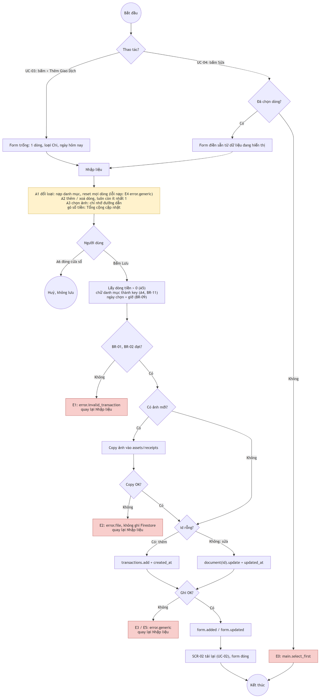
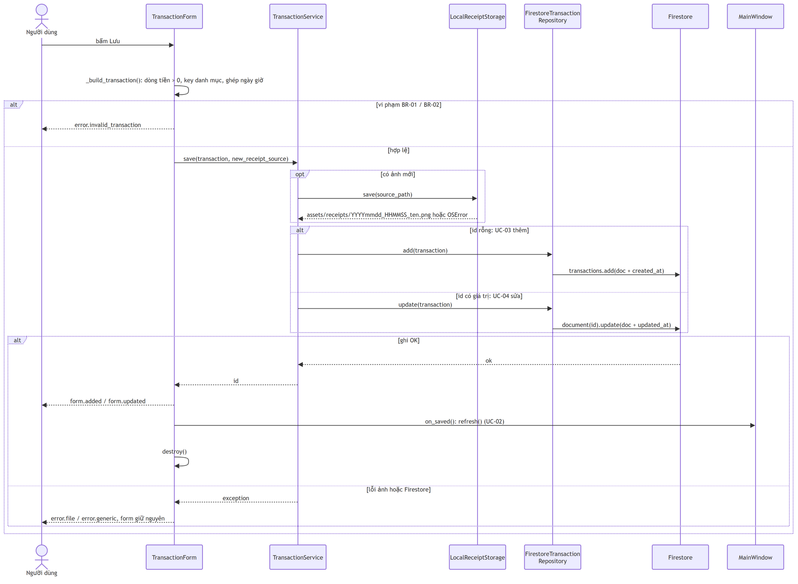

### Tiêu chí nghiệm thu
- **Given** form thêm, **When** nhập hai dòng (Ăn uống / `150000` / "Cơm trưa") và (Di chuyển / `50.000 đ` / "") rồi Lưu, **Then** document mới có `type="outflow"`, `total_amount=200000.0`, `items=[{category_key:"food", amount:150000.0, item_note:"Cơm trưa"}, {category_key:"transport", amount:50000.0, item_note:""}]`, có `created_at` và không có `updated_at`.
- **Given** đang ở 14:32:10 ngày 04/11/2026, **When** chọn ngày 01/11/2026 rồi Lưu, **Then** `date` = 01/11/2026 14:32:10, lưu theo quy ước C2.
- **Given** một dòng có tiền `0` và một dòng hợp lệ, **When** Lưu, **Then** chỉ dòng hợp lệ được ghi.
- **Given** mọi dòng đều có tiền trống, **When** Lưu, **Then** hiện `error.invalid_transaction` và không ghi gì.
- **Given** ô danh mục được gõ "Cà phê", **When** Lưu, **Then** `category_key = "Cà phê"`, và SCR-02 hiển thị nhãn "Cà phê".
- **Given** ô danh mục được gõ "Ăn uống" khi đang dùng tiếng Anh, **When** Lưu, **Then** `category_key = "food"` (tên cũ, BR-11).
- **Given** đã chọn ảnh `hoadon.png`, **When** Lưu lúc 04/11/2026 14:32:10, **Then** có file `assets/receipts/20261104_143210_hoadon.png` và `image_path` bằng đúng chuỗi đó.
- **Given** form có 1 dòng, **When** bấm `X`, **Then** vẫn còn 1 dòng.

---

## UC-04 Sửa giao dịch

| | |
|---|---|
| Màn hình | SCR-02 → SCR-03 (chế độ sửa) |
| Tiền điều kiện | Đang ở SCR-02 và đã chọn một dòng |
| Kích hoạt | Bấm `main.edit` |
| Hậu điều kiện | Thành công: document được `update` (ghi đè mọi field nghiệp vụ, thêm `updated_at`, giữ `created_at`); SCR-02 đã tải lại |

**Luồng chính**: giống UC-03, với các khác biệt sau:
1. Mở SCR-03 với dữ liệu **đang hiển thị** trên SCR-02 (không đọc lại Firestore): loại, ngày, đối tác, ghi chú, tên ảnh, và mỗi hạng mục một dòng (tiền hiển thị dạng `1.500.000 đ`).
2. Ngày giờ = ngày chọn + **giờ của giao dịch gốc** (BR-09).
3. Không chọn ảnh mới thì giữ `image_path` cũ. Chọn ảnh mới thì copy rồi thay `image_path`; file ảnh cũ vẫn để nguyên trên đĩa.
4. Ghi `document(id).update(document + updated_at)`, thông báo `form.updated`.

**Luồng thay thế**: A1–A6 như UC-03. ⚠ As-is: A1 (đổi loại) reset cả những dòng đã điền sẵn.

**Luồng lỗi**
- **E0** Chưa chọn dòng → cảnh báo `main.select_first`, không mở form.
- **E1–E4** như UC-03.
- **E5** Document đã bị xoá ở máy khác trong lúc đang sửa → `update` lỗi NotFound → `error.generic`; form giữ nguyên.

Sequence: xem `seq-uc03-04` ở UC-03 (nhánh `id có giá trị`).

### Tiêu chí nghiệm thu
- **Given** giao dịch lúc 01/11/2026 09:00:00, **When** đổi ngày thành 02/11/2026 rồi Lưu, **Then** `date` = 02/11/2026 09:00:00.
- **Given** giao dịch có ảnh, **When** sửa ghi chú mà không chọn ảnh mới, **Then** `image_path` không đổi.
- **Given** giao dịch có `created_at`, **When** Lưu, **Then** `created_at` giữ nguyên và có thêm `updated_at`.
- **Given** chưa chọn dòng nào, **When** bấm Sửa, **Then** hiện cảnh báo `main.select_first`.
- **Given** document đã bị xoá ở máy khác, **When** Lưu, **Then** hiện `error.generic` và form vẫn mở.

---

## UC-05 Xem chi tiết giao dịch

| | |
|---|---|
| Màn hình | SCR-02 → SCR-04 |
| Tiền điều kiện | Đã chọn một dòng |
| Kích hoạt | Bấm `main.view` |
| Hậu điều kiện | Không thay đổi dữ liệu |

**Luồng chính**
1. Tìm file ảnh từ `receipt_path` (tương đối → ghép với thư mục app; tuyệt đối → giữ nguyên).
2. Mở SCR-04 (modal) với thông tin chung, bảng hạng mục và ảnh thu nhỏ.
3. Bấm `dialog.close` → quay lại SCR-02.

**Luồng thay thế**
- **A1** `receipt_path` rỗng hoặc file không tồn tại (ví dụ ảnh được lưu ở máy khác) → SCR-04 không có khung Biên lai.

**Luồng lỗi**
- **E0** Chưa chọn dòng → `main.select_first`.
- **E1** File tồn tại nhưng không đọc được thành ảnh → khung Biên lai hiện `detail.receipt_error`.

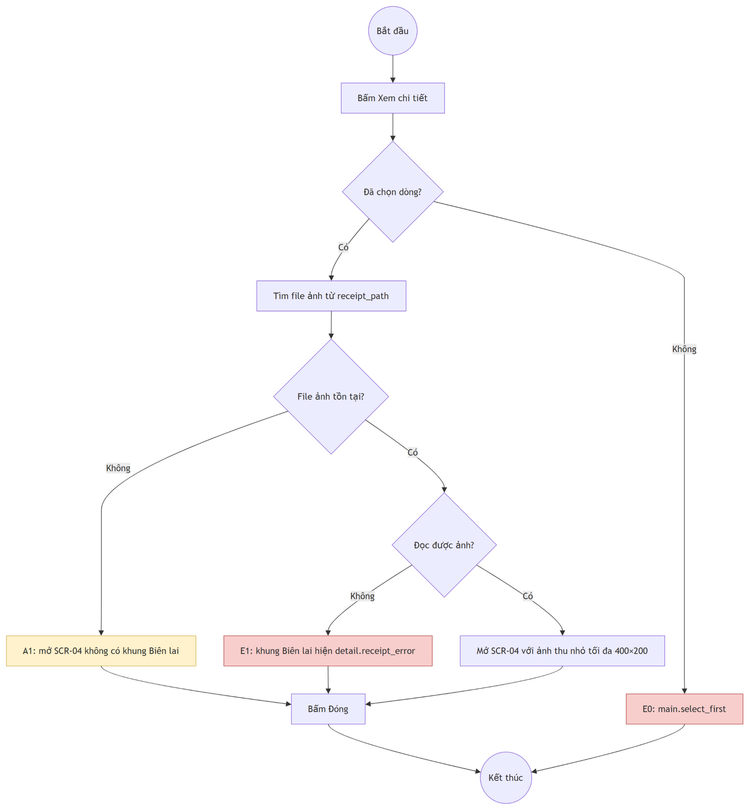
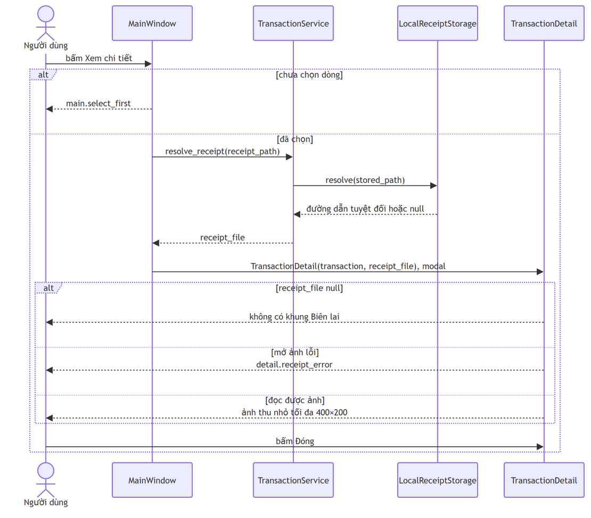

### Tiêu chí nghiệm thu
- **Given** giao dịch chi 200.000, **When** mở chi tiết, **Then** tổng hiển thị màu đỏ; với giao dịch thu thì màu xanh dương.
- **Given** `image_path` trỏ tới file không tồn tại, **When** mở chi tiết, **Then** không có khung Biên lai và không có lỗi.
- **Given** file ảnh bị hỏng, **When** mở chi tiết, **Then** khung Biên lai hiện `detail.receipt_error`.

---

## UC-06 Xoá giao dịch

| | |
|---|---|
| Màn hình | SCR-02 |
| Tiền điều kiện | Đã chọn một dòng |
| Kích hoạt | Bấm `main.delete` |
| Hậu điều kiện | Thành công: document bị xoá khỏi `transactions` (ảnh trên đĩa vẫn giữ); SCR-02 đã tải lại |

**Luồng chính**
1. Hỏi xác nhận `main.confirm_delete` (Yes / No).
2. Yes → `document(id).delete()`.
3. Thông báo `main.deleted`.
4. Tải lại kỳ (UC-02).

**Luồng thay thế**
- **A1** Chọn No → không làm gì.

**Luồng lỗi**
- **E0** Chưa chọn dòng → `main.select_first`.
- **E1** Xoá lỗi → `error.generic`; **vẫn** tải lại kỳ (bước 4).

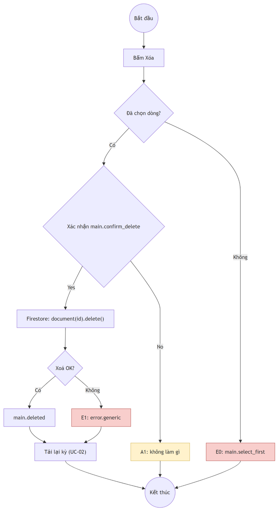
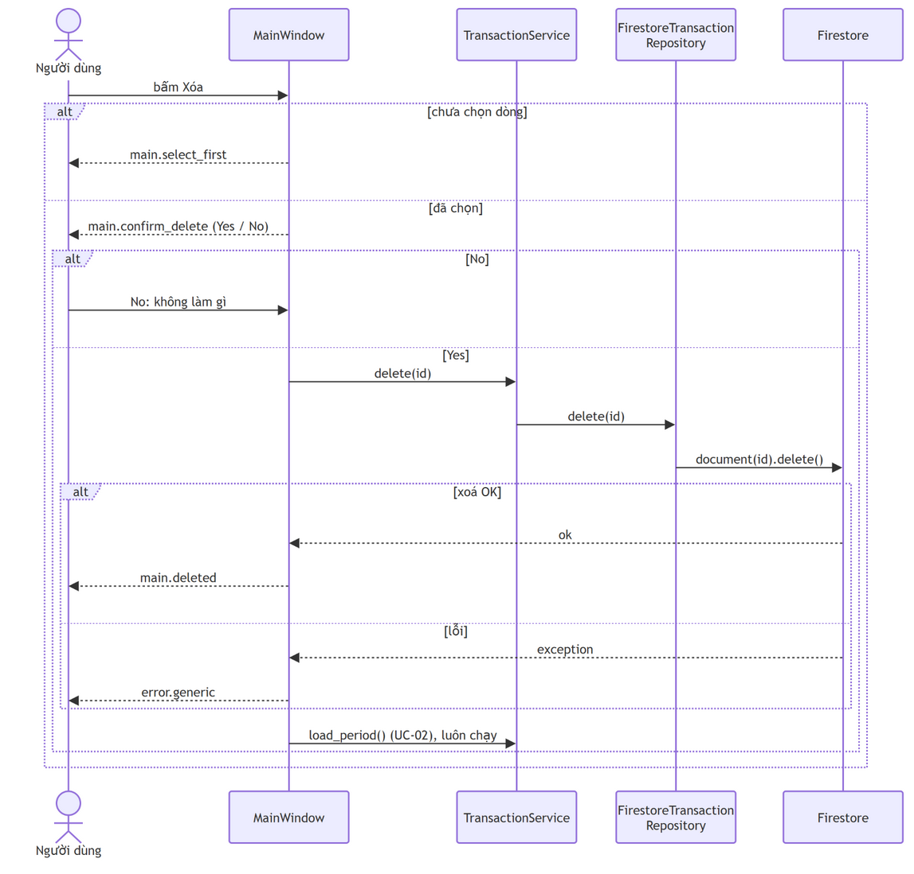

### Tiêu chí nghiệm thu
- **Given** đã chọn một giao dịch, **When** bấm Xóa rồi chọn Yes, **Then** document không còn trên Firestore, hiện `main.deleted`, và dòng biến mất khỏi bảng.
- **Given** đã chọn một giao dịch, **When** bấm Xóa rồi chọn No, **Then** không có gì thay đổi.
- **Given** mất mạng, **When** xoá, **Then** hiện `error.generic` và bảng được tải lại (cũng lỗi, nên hiện thêm `error.generic` lần nữa — as-is).

---

## UC-07 Xem biểu đồ

| | |
|---|---|
| Màn hình | SCR-02 → SCR-05 |
| Tiền điều kiện | Không có |
| Kích hoạt | Bấm `main.chart` |
| Hậu điều kiện | Không thay đổi dữ liệu |

**Luồng chính**
1. Lấy dữ liệu kỳ **đang hiển thị** (không đọc lại Firestore).
2. Mở SCR-05 (modal, phóng to): tiêu đề kỳ, biểu đồ thu (xanh lá) và biểu đồ chi (đỏ) theo BR-06.
3. Bấm `dialog.close` → quay lại SCR-02.

**Luồng thay thế**
- **A1** Chưa tải được dữ liệu kỳ nào (lần tải đầu đã lỗi) → không làm gì. ⚠ As-is.
- **A2** Kỳ không có giao dịch nào → thay hai biểu đồ bằng `chart.no_data_period`.
- **A3** Chỉ một loại không có dữ liệu → ô biểu đồ đó hiện `chart.no_data`.

**Luồng lỗi**: không có (không có I/O).

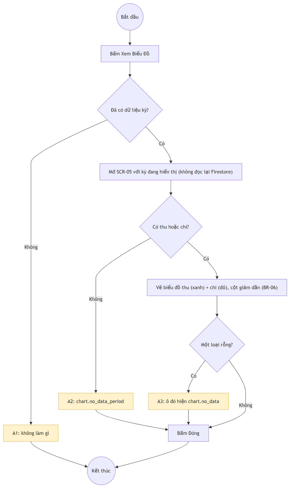

### Tiêu chí nghiệm thu
- **Given** kỳ có chi Hóa đơn 3.050.000, Ăn uống 150.000, Di chuyển 50.000, **When** mở biểu đồ, **Then** biểu đồ chi có 3 cột theo đúng thứ tự Hóa đơn, Ăn uống, Di chuyển, và trần trục Y = 3.660.000.
- **Given** kỳ chỉ có chi, **When** mở biểu đồ, **Then** ô biểu đồ thu hiện `chart.no_data`.
- **Given** kỳ rỗng, **When** mở biểu đồ, **Then** chỉ hiện `chart.no_data_period`.

---

## UC-08 Xuất báo cáo

| | |
|---|---|
| Màn hình | SCR-02 (cùng hộp thoại lưu file của hệ điều hành) |
| Tiền điều kiện | Không có |
| Kích hoạt | Bấm `main.export_word` |
| Hậu điều kiện | Thành công: có file `.docx` tại đường dẫn đã chọn, cấu trúc như mục [Báo cáo Word](02-screens.md#báo-cáo-word) |

**Luồng chính**
1. Mở hộp thoại lưu file (`report.save_title`, thư mục Desktop, tên `<report.file_prefix>_yyyyMMdd_HHmmss.docx`).
2. Người dùng chọn đường dẫn.
3. **Đọc lại** kỳ đang áp dụng từ Firestore.
4. Dựng báo cáo bằng ngôn ngữ hiện tại và ghi ra file.
5. Thông báo `report.exported` (tham số `path`).

**Luồng thay thế**
- **A1** Bấm Cancel trong hộp thoại → không làm gì.

**Luồng lỗi**
- **E1** Kỳ không có giao dịch nào → `error.no_data`, không tạo file.
- **E2** Không ghi được file (file đang mở trong Word, không có quyền) → `error.file`.
- **E3** Lỗi Firestore hoặc lỗi khác → `error.generic`.

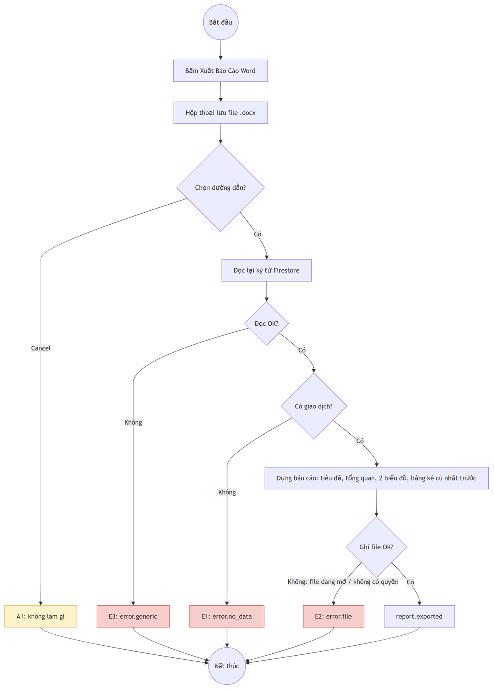
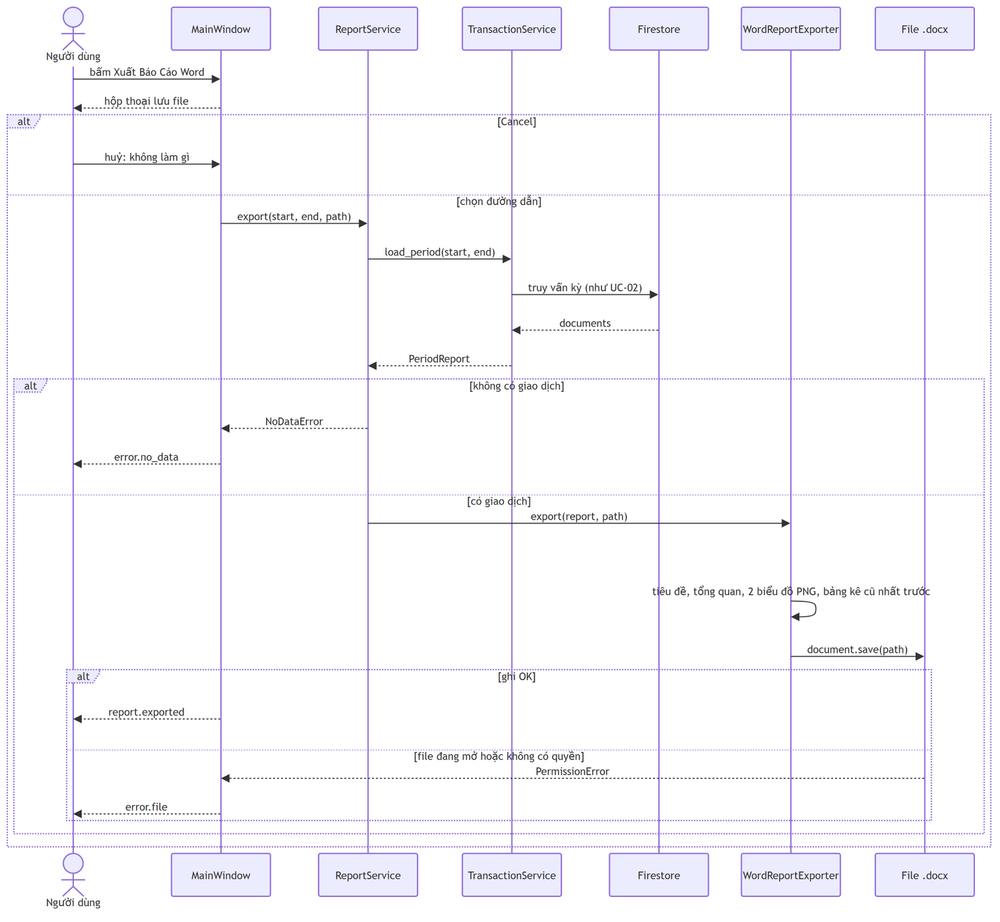

### Tiêu chí nghiệm thu
- **Given** kỳ có 3 giao dịch, **When** xuất, **Then** bảng kê có 3 dòng xếp cũ nhất trước, và mục tổng quan khớp với ⑦ trên SCR-02.
- **Given** hạng mục có ghi chú "Cơm trưa", **When** xuất bằng tiếng Việt, **Then** ô hạng mục là `- Ăn uống (Mục đích: Cơm trưa): 150.000 đ`.
- **Given** kỳ rỗng, **When** xuất, **Then** hiện `error.no_data` và không tạo file.
- **Given** file đích đang mở trong Word, **When** ghi đè, **Then** hiện `error.file`.

---

## UC-09 Đổi ngôn ngữ

| | |
|---|---|
| Màn hình | SCR-02 |
| Tiền điều kiện | Không có |
| Kích hoạt | Chọn `language.vi` hoặc `language.en` trong menu `menu.language` |
| Hậu điều kiện | SCR-02 hiển thị bằng ngôn ngữ mới; `settings.json` lưu lựa chọn |

**Luồng chính**
1. Đặt ngôn ngữ hiện tại.
2. Ghi `settings.json`.
3. Dựng lại toàn bộ SCR-02 bằng chuỗi mới; hai ô ngày quay về kỳ đang áp dụng.
4. Hiển thị lại dữ liệu kỳ đã có trong bộ nhớ (không gọi Firestore). Định dạng tiền đổi theo (`đ` / `VND`).

**Luồng thay thế**
- **A1** Cửa sổ con đang mở (SCR-03/04/05) giữ ngôn ngữ cũ cho đến khi đóng (⚠ As-is).

**Luồng lỗi**
- **E1** Ghi `settings.json` lỗi → `error.file` (hoặc `error.generic`). Giao diện **vẫn** đổi ngôn ngữ, nhưng lần mở app sau sẽ quay về ngôn ngữ cũ.

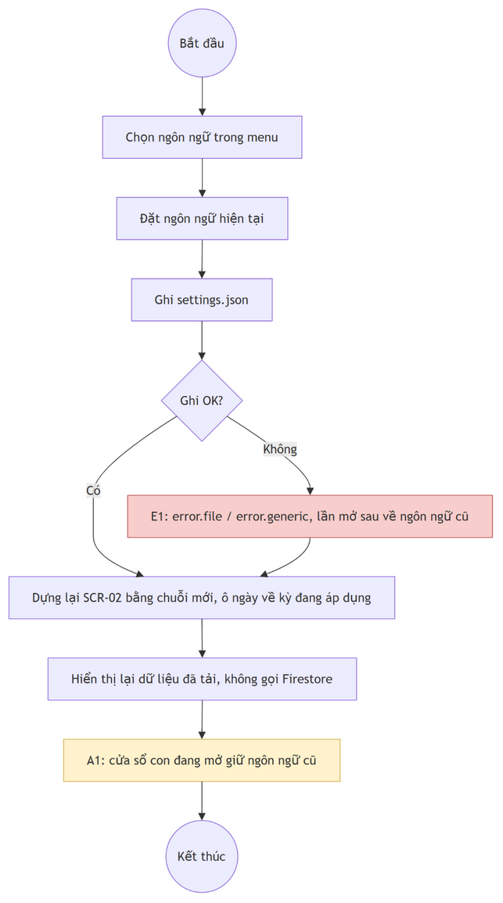

### Tiêu chí nghiệm thu
- **Given** đang dùng tiếng Việt, **When** chọn English, **Then** mọi nhãn trên SCR-02 đổi sang tiếng Anh, tiền hiển thị dạng `1,500,000 VND`, và Firestore không bị gọi.
- **Given** đã chọn English, **When** khởi động lại app, **Then** app mở bằng tiếng Anh.
- **Given** đã gõ Từ ngày mới mà chưa bấm Lọc, **When** đổi ngôn ngữ, **Then** ô ngày quay về kỳ đang áp dụng (as-is).
