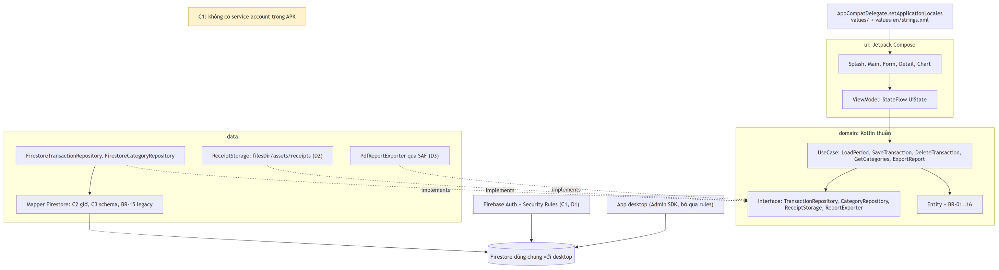

# 05 · Chuyển sang Android (Jetpack Compose)

> File này là **đề xuất**, khác với các file 01–04 vốn chỉ mô tả hành vi hiện tại. Phần **Ràng buộc** là bắt buộc
> vì bản Android dùng chung Firestore với bản desktop. Phần **Quyết định còn mở** do team Android chốt, có kèm khuyến nghị.
> Phần **Ánh xạ** chỉ là gợi ý.



## Ràng buộc bắt buộc

| ID | Ràng buộc | Lý do / cách làm |
|----|-----------|------------------|
| **C1** | **Không** nhúng `serviceAccountKey.json` (hay bất kỳ khoá admin nào) vào APK. Dùng Firebase **client SDK** (`com.google.firebase:firebase-firestore`). | Ai cũng giải nén được APK. Khoá admin có toàn quyền trên project Firebase. Desktop dùng Admin SDK nên bỏ qua Security Rules; vì vậy bật rules để bảo vệ Android **không** ảnh hưởng gì tới desktop. |
| **C2** | Quy ước giờ: Timestamp lưu trên Firestore có **giờ UTC bằng giờ hiển thị**. Áp dụng cho `date`, `created_at`, `updated_at` và hai mốc truy vấn kỳ. | Giữ cho hai app hiển thị cùng một giờ. Chi tiết ở [01-domain-data.md](01-domain-data.md#quy-ước-thời-gian). Đoạn code mẫu ở bên dưới. |
| **C3** | Ghi đúng schema hiện tại, gồm `total_amount` và `items[].item_note`. Đọc phải chấp nhận dạng legacy (`category_name`, `name`, field thiếu) theo BR-15. | Desktop và dữ liệu cũ phải đọc được document do Android ghi, và ngược lại. |
| **C4** | Không có cơ chế khoá: hai app cùng sửa một giao dịch thì bản ghi sau thắng (`update` ghi đè toàn bộ field). Mọi code Android ghi vào Firestore dùng chung được xếp **T4** (thay đổi dữ liệu đã lưu) ở project Android. | Giữ đúng hành vi as-is. Nếu cần tránh ghi đè, có thể dùng `updated_at` để kiểm tra phiên bản; việc này cũng phải sửa cả desktop. |

Đoạn code minh hoạ C2:

```kotlin
// Ghi: giờ hiển thị (LocalDateTime) -> Timestamp có cùng giờ, coi như UTC
fun LocalDateTime.toFirestoreTimestamp(): Timestamp =
    Timestamp(Date.from(this.toInstant(ZoneOffset.UTC)))

// Đọc: Timestamp -> giờ hiển thị
fun Timestamp.toDisplayDateTime(): LocalDateTime =
    this.toDate().toInstant().atOffset(ZoneOffset.UTC).toLocalDateTime()

// Truy vấn kỳ (BR-07)
val start = from.atStartOfDay().toFirestoreTimestamp()
val end = to.atTime(23, 59, 59).toFirestoreTimestamp()
db.collection("transactions")
    .whereGreaterThanOrEqualTo("date", start)
    .whereLessThanOrEqualTo("date", end)
    .orderBy("date", Query.Direction.DESCENDING)

// created_at / updated_at: LocalDateTime.now().toFirestoreTimestamp() — KHÔNG dùng FieldValue.serverTimestamp()
```

## Quyết định còn mở

| ID | Vấn đề | Các lựa chọn | Khuyến nghị | Ảnh hưởng tới desktop |
|----|--------|--------------|-------------|------------------------|
| **D1** | Xác thực | (a) Firebase Auth bằng Google hoặc email/password, Security Rules chỉ cho các UID trong danh sách cho phép; (b) Anonymous Auth (yếu, ai có app cũng ghi được); (c) không xác thực, mở rules (không chấp nhận được) | **(a)**. Dữ liệu hiện không có `userId`: cả nhóm dùng **một sổ chung**, nên rules cho mọi UID trong danh sách quyền đọc/ghi `transactions`, và chỉ đọc + tạo khi rỗng đối với `categories` | Không có (Admin SDK bỏ qua rules) |
| **D2** | Ảnh biên lai | (a) Lưu trong bộ nhớ trong của app (`filesDir/assets/receipts/`), `image_path` cùng định dạng `assets/receipts/...`; (b) chuyển sang Firebase Storage, `image_path` = đường dẫn Storage | **(a)** để giữ tương thích. Ảnh do máy kia tạo không có trên máy này → ẩn khung Biên lai (đúng như as-is khi file không tồn tại, UC-05 A1). (b) là task riêng sau này | (a) không có. (b) phải sửa cả `receipt_storage.py` |
| **D3** | Xuất báo cáo | (a) PDF bằng `android.graphics.pdf.PdfDocument`, lưu qua SAF `ActivityResultContracts.CreateDocument("application/pdf")` hoặc chia sẻ bằng `Intent.ACTION_SEND`; (b) `.docx` bằng Apache POI (nặng, nhiều vấn đề trên Android); (c) CSV | **(a)**, giữ đúng 6 phần nội dung của [Báo cáo Word](02-screens.md#báo-cáo-word). Tên file `<report.file_prefix>_yyyyMMdd_HHmmss.pdf` | Không có |
| **D4** | Offline | (a) Giữ offline persistence mặc định của SDK (ghi được khi mất mạng, tự đồng bộ sau); (b) tắt persistence để giống as-is (báo lỗi khi mất mạng) | **(a)**. SCR-01 trở thành màn khởi tạo: kiểm tra đăng nhập (D1) → seed danh mục nếu rỗng (BR-14) → vào Main. Khi offline, seed bị hoãn đến lúc có mạng; danh sách danh mục lấy từ cache | Không có. Lưu ý: desktop chỉ thấy dữ liệu ghi offline sau khi Android đồng bộ xong |
| **D5** | Cache danh mục | (a) Đọc một lần mỗi phiên như as-is; (b) lắng nghe realtime bằng `addSnapshotListener` | **(a)**, vì app không bao giờ sửa danh mục ngoài lúc seed | Không có |

## Ánh xạ desktop → Compose

| Desktop (Tkinter) | Compose / Android | Ghi chú |
|-------------------|-------------------|---------|
| `Tk` / `Toplevel` (SCR-01..05) | Destination trong Navigation Compose | SCR-04, SCR-05 modal → màn full-screen; SCR-03 → màn full-screen hoặc `ModalBottomSheet` |
| `ttk.Treeview` + chọn dòng rồi bấm nút | `LazyColumn` gồm các `Card`; tap → SCR-04; Sửa/Xoá qua menu hoặc `SwipeToDismissBox` | Cảnh báo `main.select_first` không còn cần thiết |
| `messagebox.showerror` / `askyesno` | `AlertDialog` | Lỗi và xác nhận xoá |
| `messagebox.showinfo` | `Snackbar` | `form.added`, `main.deleted`, `report.exported` |
| `tkcalendar.DateEntry` | Material 3 `DatePicker` / `DateRangePicker` | Lọc kỳ có thể dùng `DateRangePicker` |
| `ttk.Combobox` cho phép gõ | `ExposedDropdownMenuBox` + `OutlinedTextField` cho phép nhập | Giữ được danh mục tự đặt (BR-11) |
| Ô tiền chữ tự do + `parse_money` | `OutlinedTextField` với `KeyboardType.Number` + `VisualTransformation` hiển thị dấu phân cách | Tránh các quirk của BR-10 |
| `filedialog.askopenfilename` (ảnh) | Photo Picker (`PickVisualMedia`) | Copy vào `filesDir` khi lưu (BR-13) |
| `filedialog.asksaveasfilename` (.docx) | SAF `CreateDocument` | Xem D3 |
| matplotlib (biểu đồ cột) | Compose `Canvas` hoặc thư viện Vico | BR-06, quy tắc vẽ ở SCR-05 |
| PIL thumbnail | Coil `AsyncImage` | |
| `threading` + poll 100 ms | Coroutine (`viewModelScope`) + `StateFlow<UiState>` | Có trạng thái loading thật |
| `locales/*.json` + `t()` | `res/values/strings.xml` (vi, mặc định) + `res/values-en/strings.xml` | Xem [04-i18n-format.md](04-i18n-format.md) |
| `settings.json` (ngôn ngữ) | `AppCompatDelegate.setApplicationLocales` + `locales_config.xml` | Hệ thống tự lưu lựa chọn |
| `firebase_admin` + service account | Firebase client SDK + Auth (C1, D1) | |
| `assets/receipts/` cạnh app | `context.filesDir/assets/receipts/` | Xem D2 |
| `TransactionService`, `ReportService` | UseCase / Repository (Kotlin) | Giữ nguyên ranh giới domain ↔ data như bản desktop |

## Ngoài phạm vi

Những tính năng as-is **không có**, nên bản Android cũng không cần có trong lần chuyển đầu tiên: quản lý danh mục (thêm/sửa/xoá), gỡ ảnh biên lai khỏi giao dịch, tìm kiếm / lọc theo danh mục, nhiều người dùng với sổ riêng, đồng bộ ảnh giữa các máy.
