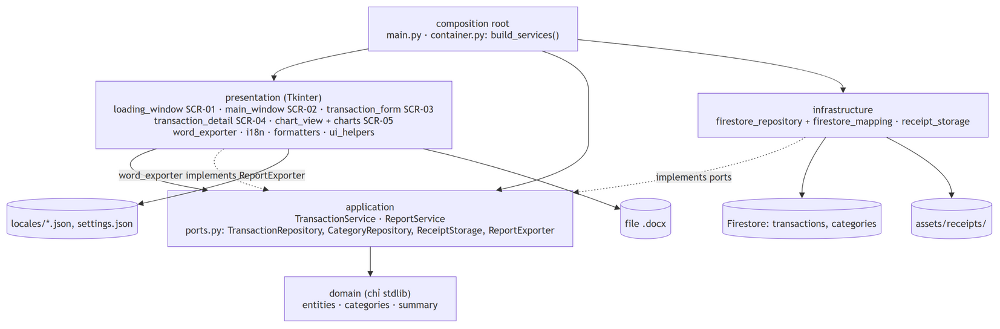

# Spec chuyển giao: Quản lý Chi tiêu → Android (Jetpack Compose)

Bộ tài liệu này mô tả **toàn bộ hành vi** của app desktop "Phần mềm Quản lý Chi tiêu" (Python 3 / Tkinter + Firestore),
đủ để làm lại app tương đương bằng Jetpack Compose mà **không cần đọc mã Python**. Bản Android **dùng chung database
Firestore** với bản desktop, nên schema dữ liệu ở [01-domain-data.md](01-domain-data.md) là hợp đồng bắt buộc.

- **Nguồn:** commit `5614abe` của repo desktop. Mỗi quy tắc đều ghi `file.py:dòng` để đối chiếu khi cần.
- **Phạm vi:** 5 màn hình, 9 use case, xuất báo cáo, i18n vi/en, hợp đồng Firestore, ảnh biên lai.
- **Ngoài phạm vi:** code Android; sửa app desktop; các tính năng as-is không có (xem cuối [05-android-mapping.md](05-android-mapping.md#ngoài-phạm-vi)).

## Thuật ngữ

| Thuật ngữ | Nghĩa |
|-----------|-------|
| Giao dịch (`Transaction`) | Một lần thu hoặc chi, gồm **một hoặc nhiều hạng mục**, có ngày giờ, đối tác, ghi chú chung, ảnh biên lai |
| Hạng mục (`TransactionItem`) | Một dòng trong giao dịch: danh mục + số tiền + ghi chú |
| Loại | `inflow` (Thu) hoặc `outflow` (Chi) |
| Danh mục / key | Danh mục lưu bằng **key trung lập ngôn ngữ** (`food`, `salary`…) và hiển thị qua i18n. Người dùng có thể gõ tên mới → **danh mục tự đặt**, key chính là tên đó |
| Kỳ | Khoảng ngày đang xem `[từ 00:00:00, đến 23:59:59]`, mặc định từ đầu tháng đến hôm nay |
| Biên lai | Ảnh đính kèm giao dịch, lưu trên ổ đĩa của máy đã thêm nó |
| `SCR-xx`, `UC-xx`, `BR-xx`, `C1..C4`, `D1..D5` | ID màn hình, use case, quy tắc nghiệp vụ, ràng buộc, quyết định mở; dùng để trích dẫn chéo |
| `A1..` / `E1..` | Luồng thay thế / luồng lỗi trong một use case |
| ⚠ As-is | Hành vi hiện tại có vẻ lạ hoặc là lỗi nhỏ, được ghi **đúng như code** kèm khuyến nghị. Team Android tự quyết giữ hay sửa |
| 💡 Gợi ý Compose | Đề xuất cho bản Android, không phải mô tả hành vi hiện tại |
| `` `main.add` `` | Key i18n; tra chuỗi vi/en trong [04-i18n-format.md](04-i18n-format.md#bảng-chuỗi) |

## Kiến trúc hiện tại



| Tầng | File | Vai trò |
|------|------|---------|
| domain | `app/domain/entities.py`, `categories.py`, `summary.py` | Entity, validate, tính tổng; chỉ dùng stdlib |
| application | `app/application/transaction_service.py`, `report_service.py`, `ports.py` | Use case; giao tiếp ra ngoài qua interface (`ports.py`) |
| infrastructure | `app/infrastructure/firestore_repository.py`, `firestore_mapping.py`, `receipt_storage.py` | Firestore, ảnh biên lai trên ổ đĩa |
| presentation | `app/presentation/*.py` | 5 cửa sổ Tkinter, biểu đồ matplotlib, xuất Word, i18n, định dạng |
| composition root | `app/container.py`, `main.py` | Nối dependency, mở SCR-01 rồi SCR-02 |

Quy tắc phụ thuộc: presentation → application → domain; infrastructure → application → domain. Bản Android nên giữ ranh giới này (xem `architecture-android` trong [05-android-mapping.md](05-android-mapping.md)).

## Mục lục

| File | Nội dung | Dùng khi code phần |
|------|----------|--------------------|
| [01-domain-data.md](01-domain-data.md) | Entity, 16 quy tắc nghiệp vụ BR-01..16, hợp đồng Firestore, dữ liệu legacy, quy ước giờ, ảnh biên lai | Data + domain |
| [04-i18n-format.md](04-i18n-format.md) | 111 chuỗi vi/en (kèm tên gợi ý trong `strings.xml`), định dạng tiền / ngày | Resource, formatter |
| [02-screens.md](02-screens.md) | Wireframe, thành phần, **bảng sự kiện** (mọi thao tác click → kết quả), trạng thái của SCR-01..05; cấu trúc báo cáo | UI |
| [03-use-cases.md](03-use-cases.md) | UC-01..09: luồng chính / thay thế / lỗi, activity + sequence, **tiêu chí nghiệm thu Given/When/Then** | ViewModel, test |
| [05-android-mapping.md](05-android-mapping.md) | Ràng buộc C1..C4, quyết định mở D1..D5, ánh xạ Tkinter → Compose | Kiến trúc, setup project |

**Thứ tự nên đọc khi code:** 01 → 04 → 02 → 03 → 05. Riêng phần **Ràng buộc** của 05 nên đọc ngay từ đầu.

## Diagram

24 diagram nằm chung trong một file nhiều trang [`diagrams/spec.drawio`](diagrams/spec.drawio). Mỗi trang có ảnh PNG tương ứng trong `diagrams/png/`, và ảnh đó được chèn vào file `.md` phù hợp. Mọi diagram đều có bản chữ tương đương trong `.md`, nên người chỉ đọc chữ không bị thiếu thông tin.

| Nhóm | Trang |
|------|-------|
| Kiến trúc | `architecture-current`, `architecture-android` |
| Dữ liệu | `data-model` |
| UI | `navigation`, `wf-scr01` … `wf-scr05` (wireframe as-is, số ①② khớp bảng sự kiện) |
| Use case | `use-cases`, `act-uc01` … `act-uc09` (activity, nhánh thay thế tô vàng, nhánh lỗi tô đỏ), `seq-uc01`, `seq-uc02`, `seq-uc03-04`, `seq-uc05`, `seq-uc06`, `seq-uc08` |

Sửa diagram: mở `spec.drawio` bằng draw.io desktop hoặc app.diagrams.net. Sau khi sửa trang thứ *n*, xuất lại PNG bằng lệnh:

```bash
draw.io -x -f png -p <n> -b 10 -o diagrams/png/<tên-trang>.png diagrams/spec.drawio
```

Trang thứ *n* tính từ 1, theo thứ tự trong bảng trên.
